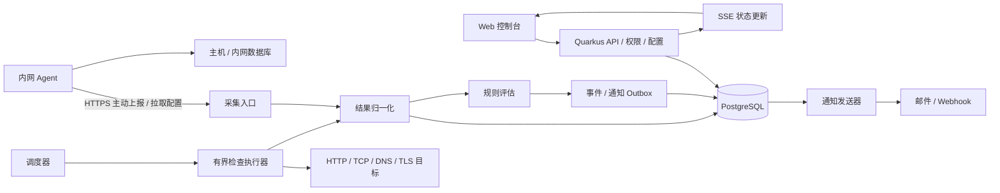

# Geek Monitor 产品与技术规划

文档版本：v0.1  
编写日期：2026-10-10  
状态：实施中；本文中的功能、容量和工期均为设计目标，实施状态见第 12 节。

## 1. 产品定位

Geek Monitor 是面向个人开发者、小型团队和自托管运维场景的统一监控平台，通过一个控制台管理服务器、网站、接口、数据库和基础服务的健康状态，完成“发现异常 → 通知负责人 → 查看证据 → 确认恢复”的闭环。

核心问题：服务是否可用、响应是否变慢、资源是否即将耗尽、故障发生在哪里、谁已经处理。首版追求部署简单、判断可信、告警可用，后续扩展多地域探测和较大规模指标分析。

### 1.1 规划假设

- 首版为单组织使用，可管理多个项目和环境；暂不提供面向客户的商业多租户计费。
- 优先支持 Linux 服务器，数据库优先 PostgreSQL、MySQL 和 Redis。
- 中心服务可访问公网目标；内网服务器通过 Agent 主动连接中心，不要求开放入站端口。
- 延续仓库现有 Kotlin、Quarkus、Gradle 和 Java 21 基础；管理界面先采用浏览器 Web 控制台。
- 首版按最多 100 台主机、500 个主动检查项规划，实际承载能力须经压测确认。

### 1.2 典型使用场景

| 场景 | 用户操作 | 预期结果 |
| --- | --- | --- |
| 网站故障 | 添加 URL、检查间隔和通知渠道 | 连续失败后收到告警，恢复后收到恢复通知 |
| 服务器资源紧张 | 安装 Agent 并选择主机模板 | 查看 CPU、内存、磁盘趋势，提前收到容量告警 |
| 数据库变慢 | 绑定只读监控凭据和探测位置 | 区分连接失败、查询超时、连接数接近上限 |
| 定时备份未执行 | 配置心跳任务并由脚本上报 | 超过预期时间和宽限期后告警 |
| 计划维护 | 设置维护窗口 | 保留检查结果，抑制维护期通知 |

### 1.3 首版边界

首版覆盖可用性、基础性能指标、故障事件和通知。不包含全量日志检索、分布式链路追踪、流量抓包、自动执行修复命令、任意脚本市场或完整 Kubernetes 管理。相关能力通过后续集成解决，避免将第一阶段变成完整可观测性平台。

## 2. 监控对象与采集范围

“资源”表示一台主机、一个网站或数据库实例；“监控项”表示针对资源的一项检查或指标规则。一个资源可以绑定多个监控项，不能仅凭某个端口可连接就判定整个服务健康。

| 类型 | 首版采集或检查 | 后续扩展 | 方式 |
| --- | --- | --- | --- |
| Linux 主机 | CPU、load、内存、swap、磁盘空间/inode、网络收发、在线状态 | 磁盘 I/O、温度、进程与 systemd 服务 | Agent 周期上报 |
| HTTP/HTTPS | 状态码、总耗时、超时、重定向、文本/JSON 断言 | DNS/TCP/TLS/首字节耗时分解、跨地域探测 | 中心或探测节点主动请求 |
| TLS 证书 | 证书有效期、主机名和信任链验证 | 自定义 CA 管理、证书变化事件 | TLS 握手 |
| TCP | 指定端口连通性及建立连接耗时 | 协议握手模板 | 主动连接 |
| DNS | 指定解析器、记录类型、解析结果断言和耗时 | 多解析器一致性 | 主动查询 |
| PostgreSQL/MySQL | 连接、轻量查询、查询耗时、连接数/上限 | 锁等待、复制延迟、慢查询汇总 | 内网 Agent 或探测节点 |
| Redis | PING、内存、客户端数、淘汰计数 | 主从复制与持久化状态 | 内网 Agent 或探测节点 |
| 心跳任务 | 最近运行时间、成功/失败、超时缺报 | Cron 日历与任务耗时分布 | 业务脚本调用上报接口 |
| 容器 | 后续提供 | 容器状态、重启次数、资源、健康检查 | 本地主机采集 |
| 通用指标 | 后续提供 | Prometheus 格式接入、自定义业务指标 | 受控抓取或批量上报 |

### 2.1 检查配置

每个监控项包含名称、所属项目、环境、标签、负责人、目标、探测位置、间隔、超时、判断条件、告警策略、凭据引用和启停状态。

建议初始默认值如下，允许按类型调整：

- HTTP/TCP：60 秒一次，单次总超时 10 秒；HTTP 默认成功状态码为 200–299，可显式修改。
- DNS：60 秒一次，超时 5 秒；明确记录类型及期望结果。
- Agent：30 秒采集并批量上报一次；超过 90 秒未收到心跳进入采集异常。
- 数据库：60 秒一次，总执行预算 10 秒；PostgreSQL/MySQL 使用固定 `SELECT 1`，Redis 使用 `PING`，不执行自定义 SQL。
- TLS：每 6 小时检查一次，默认提前 30/14/7 天分级提醒。
- 心跳任务：首版使用“预期间隔 + 宽限期”，Cron 和时区日历作为扩展。

默认不在一个周期内立即多次重试，由连续失败阈值处理抖动。检查间隔必须大于总执行预算，同一检查不重叠执行。

### 2.2 HTTP 语义

支持 GET/HEAD；POST 仅在用户显式确认目标是无副作用端点后启用，且请求不携带正文、不自动跟随重定向。自定义请求头值采用 AES-GCM 加密存储，读取配置只返回头名称、不返回值；请求执行时才解密，编辑时空值保留原密钥，删除行才能移除。项目级共享 HTTP 凭据可重复引用，并由项目管理员限制到精确协议、主机和端口；监控只能引用同项目凭据，目标源站须在其授权范围内，删除仍被引用的凭据会被拒绝。GET/HEAD 跨源重定向时不转发自定义请求头，且每一跳重新校验目标地址。当前 JSON 断言采用 RFC 6901 JSON Pointer 与 JSON 字面量做类型精确比较，例如路径 `/status/ready`、期望值 `true`；缺少路径、响应不是有效 JSON 或值不一致均为断言失败。正文包含和 JSON 断言可同时配置，须全部通过。GET/HEAD 默认最多跟随 5 次重定向。响应体读取上限建议 1 MiB，默认不保存正文，只保存经过脱敏的错误摘要。

禁用 TLS 校验需要明确提示并记录审计，监控界面持续显示该配置。证书正常、端口连通、HTTP 成功和业务断言成功应分别呈现。

### 2.3 主机及数据库指标语义

CPU 使用率由相邻计数器差分得到，首次采样显示待采集；内存同时展示可用内存和使用率；磁盘按挂载点统计并默认过滤临时伪文件系统。网络速率由累计计数器差分计算，重启或计数器回退时重置基线。

数据库采用内置固定查询模板和最小权限账号，不开放任意 SQL 执行。PostgreSQL/MySQL 使用 `SELECT 1`，Redis 使用 `PING` 做可用性判断；检查成功后还会尝试采集只读统计。PostgreSQL 连接数按实例统计，MySQL 使用全局状态；Redis 读取 `INFO clients`、`INFO memory`、`INFO stats` 及 `CONFIG GET maxclients`，采集当前客户端数/连接上限、已用内存/配置的 `maxmemory`、内存使用率及累计淘汰键数。未配置 Redis `maxmemory` 时仍报告已用内存，但不产生上限和使用率。统计查询为可选项：账号权限不足时只省略对应指标并保持可用性为 UP，不把指标权限不足误判为数据库故障。指标每 60 秒采样，可在数据库资源曲线中查看并用于阈值规则；规则要求至少 240 秒窗口，覆盖率不少于 80%、采样空洞不超过两个周期，数据不足时为 UNKNOWN。数据库凭据应用层加密保存，API 只返回凭据是否已配置；更新时密码留空表示沿用原凭据。启用 PostgreSQL/MySQL TLS 时使用 JVM 信任库验证 CA 链；为固定到已校验 IP 的连接，当前关系型数据库检查尚不校验证书主机名。Redis TLS 校验证书链和主机名。

## 3. 用户功能与页面

### 3.1 页面结构

| 页面 | 主要内容与交互 |
| --- | --- |
| 总览 | 健康/异常/未知资源数量、活跃故障、最近事件、关键资源趋势 |
| 资源列表 | 项目、环境、标签、类型和状态筛选；批量暂停和绑定告警策略 |
| 资源详情 | 当前状态、最后采集时间、指标曲线、检查历史、关联故障和维护记录 |
| 监控配置 | 分类型配置向导、凭据选择、单次试运行及检查结果解释 |
| 故障中心 | 当前/历史事件、级别、确认人、处理备注、通知记录和恢复时间 |
| 告警与通知 | 规则、阈值、通知渠道、分组、静默和维护窗口 |
| Agent 管理 | 注册、在线状态、版本、配置同步状态、吊销和更新提示 |
| 系统设置 | 项目、成员、角色、凭据、保留策略、审计及备份状态 |
| 状态页（后续） | 发布选定服务的可用性和人工公告，不暴露内网信息 |

资源详情提供最近 1 小时、24 小时、7 天、30 天范围。无数据、采集延迟和维护区间必须可见，曲线不得把缺失值补成零或健康。

### 3.2 核心操作流程

1. 创建项目和环境，添加资源。
2. 选择模板，配置目标、采集位置和凭据。
3. 执行一次试运行，展示 DNS、网络、认证或断言错误。
4. 保存监控项，绑定规则和通知渠道。
5. 发生异常后生成事件并发送通知。
6. 负责人确认事件、填写备注；系统检测恢复后关闭事件。

试运行遵守正式检查相同的网络访问策略、超时与限流。通知渠道测试由用户主动触发，并展示“测试通知”标识。

### 3.3 角色

- 管理员：管理成员、项目、凭据、节点和系统配置。
- 运维人员：管理授权项目的监控项、规则和事件，不能读取凭据明文。
- 只读成员：查看授权项目的状态、指标和事件。

首版角色绑定账号，同一账号在所有项目使用同一角色；项目成员关系单独决定可访问范围。管理员可为项目添加新账号或已有账号、移除项目成员并调整账号角色。新账号需设置至少 12 个字符的初始密码；已有账号沿用当前角色。不能通过当前会话修改自身角色，也不能移除或降级某项目的最后一位管理员。

访问控制同时作用于 API、实时事件流和导出；首版单组织也保留项目级访问边界。

## 4. 状态、规则与告警

### 4.1 状态模型

监控健康状态采用 `PENDING`（等待首次结果）、`UP`、`DEGRADED`、`DOWN`、`UNKNOWN`。暂停和维护是独立控制标记，不覆盖原始健康记录。

- 主动检查得到确定的连接失败、超时或断言失败，属于失败证据。
- 探测节点失联、任务未执行、结果过期，属于 UNKNOWN，不能直接判为目标 DOWN。
- 性能阈值持续超限可判为 DEGRADED；核心可用性失败达到阈值后判为 DOWN。
- 主机 Agent 失联生成“采集失联”事件，不能据此断言主机宕机；可结合独立 TCP 检查辅助定位。
- 多监控项资源由标记为“关键”的检查聚合：关键项 DOWN 优先，其次关键项 UNKNOWN，再考虑性能降级；非关键项异常单独展示。

### 4.2 默认规则示例

| 规则 | 触发条件 | 恢复条件 |
| --- | --- | --- |
| HTTP 不可用 | 连续 3 个有效周期失败 | 连续 2 个有效周期成功 |
| 响应变慢 | 连续 5 分钟每次有效采样耗时 > 2 秒 | 连续 3 分钟低于 1.5 秒 |
| CPU 过高 | 连续 5 分钟使用率 > 90% | 连续 3 分钟低于 80% |
| 磁盘空间不足 | 连续 3 次使用率 > 85%；> 95% 升级严重级别 | 连续 3 次低于对应阈值 5 个百分点 |
| 数据库连接紧张 | 连续 3 分钟连接数/上限 > 80% | 连续 3 分钟低于 70% |
| 心跳缺失 | 超过预期间隔与宽限期 | 收到新的有效成功上报 |

以上为可修改模板。持续时间规则要求窗口内有效采样覆盖率至少 80%，且不存在超过两倍采样间隔的空洞；缺失时进入数据不足状态，不跨空洞累计持续时长。

首版规则支持数值比较、连续次数、持续窗口、恢复阈值和严重级别，不开放任意表达式脚本。后续增加组合条件和依赖拓扑。

### 4.3 事件生命周期与降噪

事件按“规则 + 监控项 + 探测位置”去重，状态为打开、已确认、已恢复。确认表示有人处理，不能将服务标为健康。

- 同一异常期间复用事件，累加失败次数；默认每 30 分钟提醒一次，可关闭。
- 支持通知合并和每渠道速率上限，避免大量资源同时失联造成通知风暴。
- 维护期继续采集并记录异常，抑制通知；维护结束后重新累计触发条件。
- 静默只影响通知。Agent 失联时抑制依赖该 Agent 的指标缺失通知，并显示抑制原因。
- 事件关闭后再次达到失败阈值产生新事件，保留故障历史。
- 级别升级绕过普通重复提醒冷却，但仍受渠道速率限制。

首版实现邮件和通用 Webhook；后续通过适配器支持企业微信、钉钉、飞书和 Telegram。通知包含资源、环境、故障时间、实际值、阈值、探测位置和事件链接。

通知采用持久化发送记录、指数退避和最大重试次数，失败可在控制台查看。投递至少一次；向支持的接收方提供幂等键，外部渠道仍可能产生重复消息。发送前检查事件版本，过期的故障消息应取消或改为包含恢复状态的汇总，避免恢复消息之后再收到陈旧故障提醒。

### 4.4 可用率口径

按计划检查周期划分时间片：检查结果最多延续一个配置周期，成功为 UP，确定失败为 DOWN，未执行、结果过期或暂停/停用后尚未重新检查为 UNKNOWN；性能降级但可用的时间仍计入可用率，并作为可用时长的子集单独统计。统计按 UTC 整点小时汇总并保留 180 天。

`可用率 = UP 时长 / (UP 时长 + DOWN 时长)`；同时展示 `数据覆盖率 = (UP + DOWN) / 应监控时长`。维护和暂停时长从应监控时长中剔除，并公开剔除时长；UNKNOWN 不计成功。没有有效结果时展示“无数据”。告警的连续失败确认只控制通知，不抹去之前已观察到的失败时间片。

## 5. 技术架构

### 5.1 首版部署与选型

首版采用模块化单体：一个 Quarkus 应用承载控制台 API、调度、规则与通知，一个 PostgreSQL 实例保存配置和历史，受监控主机按需安装 Agent。前端作为静态资源交付；框架在页面原型阶段确定，不作为监控能力的前置依赖。

沿用当前 JVM 运行方式，原生镜像列为后续优化。Agent 建议独立为小型 Go 程序，以便单文件部署；这是拟定选型，需在 P0 验证平台适配和资源占用后确定。

数据库先统一存储配置、检查结果和受控数量的指标；达到容量边界后，将指标存储抽象接入专用时序系统，关系库继续负责配置与事件。首版不强制依赖 Redis、消息中间件或独立时序数据库。

### 5.2 模块划分

建议在现有 `com.geekcorelab.geekmonitor` 包下按业务划分：

| 模块 | 职责 |
| --- | --- |
| identity / project | 用户、角色、项目授权 |
| resource / monitor | 资源、监控定义、模板与配置版本 |
| scheduler / checker | 到期任务、并发限制、协议适配、执行预算 |
| agent / ingestion | 注册、鉴权、配置分发、上报校验和去重 |
| metric / retention | 指标存储、聚合、查询及过期清理 |
| rule / incident | 状态机、规则评估、事件与维护策略 |
| notification | 渠道配置、Outbox、投递与重试 |
| audit / system | 审计、平台自监控及运维接口 |

检查适配器统一输出执行 ID、计划时间、开始/结束时间、探测位置、结果类别、标准指标及脱敏错误码。网络失败、认证失败、权限不足、断言失败和执行器内部错误分别编码。

### 5.3 调度与一致性

首版单中心调度，使用 Quarkus 定时触发器扫描到期监控项，并将到期任务写入持久化执行表；业务监控定义保存在数据库中。调度增加小幅随机偏移，避免整分钟流量峰值。

按探测节点、协议和目标设置并发上限，使用有界队列。当前单节点每个协议目标最多并行执行 4 项；HTTP 目标按 scheme、host 和 port 归并，TCP、TLS 与数据库检查按 host 和 port 归并，DNS 按查询域名和 resolver 归并，心跳及内部规则按监控项隔离。目标名额已满时本次到期任务记为 `UNKNOWN/TARGET_CONCURRENCY_LIMIT`，执行完成或全局队列拒绝时释放名额。任务过期后记为未执行，不在恢复时无上限补跑。一次检查结果必须同时提交结果记录和待评估记录，评估器可在重启后继续处理；事件更新与通知 Outbox 同事务提交。

后续多中心部署引入数据库任务租约、租约代次和唯一执行键，拒绝旧持有者提交过期结果。Quarkus 提供支持持久化和集群调度的 Quartz 扩展，可作为多实例调度候选；业务结果和通知仍须独立实现幂等。[Quarkus Quartz 官方指南](https://quarkus.io/guides/quartz/)

### 5.4 Agent 通信

Agent 通过 HTTPS 主动注册、拉取配置并批量上报；中心不主动连接内网 Agent。注册使用短期一次性令牌，成功后签发独立节点凭据，可单独轮换和吊销。

首版 Agent 只支持内置采集器，不接收任意 Shell 命令。断网时使用有大小与时间上限的本地队列；恢复后限速补传。每批携带节点 ID、启动 ID、递增序号、采样时间和配置版本，服务端据此去重。

历史补传仅更新历史曲线，超过当前状态有效窗口的数据不重新触发即时故障或恢复；时钟偏移超出阈值时标记采样不可信，以服务端接收时间辅助判断节点在线状态。

## 6. 数据模型与接口草案

### 6.1 核心实体

| 实体 | 关键字段与约束 |
| --- | --- |
| Project / Membership | 项目、用户、角色；成员关系唯一 |
| Resource | 项目、类型、名称、环境、标签、负责人 |
| Monitor | 资源、检查类型、目标配置、间隔、超时、探测节点、配置版本 |
| Credential | 项目、AES-GCM 加密的 HTTP 请求头、精确授权源站、版本；API 不返回明文 |
| Agent | 节点标识、凭据摘要、版本、最后心跳、配置版本 |
| CheckExecution | 执行 ID、计划时间、租约、状态；监控项/位置/计划时间唯一 |
| CheckResult | 执行 ID、采样/接收时间、状态、耗时、错误码；执行 ID 唯一 |
| MetricSample / MetricRollup | 资源、指标名、受限标签、时间、值；聚合保存 count/sum/min/max |
| AlertRule | 监控项、条件、窗口、恢复阈值、级别、版本 |
| Incident / IncidentEvent | 去重键、状态、打开/恢复时间、确认人、状态变更历史 |
| NotificationOutbox / Delivery | 事件版本、渠道、幂等键、尝试次数、下次发送时间 |
| Maintenance / AuditLog | 作用范围、有效期；操作人、操作类型、脱敏变更摘要 |

检查结果和指标按时间分区，索引围绕项目、监控项、资源和时间范围设计。活跃事件施加去重约束。删除监控项采用软删除，历史结果按保留策略清理。

### 6.2 API 范围

统一使用 `/api/v1`，分页、过滤和错误码采用同一约定；更新配置带版本号以检测并发覆盖。

| 方法与路径 | 用途 |
| --- | --- |
| `GET/POST /projects`、`/resources`、`/monitors` | 查询与创建项目、资源、监控项 |
| `GET/PATCH/DELETE /monitors/{id}` | 查看、更新与软删除 |
| `POST /monitors/{id}/test` | 限流的单次试运行 |
| `GET/POST /projects/{id}/credentials`、`PATCH/DELETE /projects/{id}/credentials/{credentialId}` | 项目管理员管理共享 HTTP 凭据；成员只能查看名称和请求头名称 |
| `GET /monitors/{id}/results` | 分页查询历史检查结果 |
| `GET /resources/{id}/metrics` | 按时间和分辨率查询曲线 |
| `POST /agent-enrollments` | 管理员生成短期注册令牌 |
| `POST /agents/register` | 节点兑换注册凭据 |
| `GET /agents/{id}/config` | 节点拉取授权配置 |
| `POST /agents/{id}/batches` | 幂等批量上报 |
| `POST /heartbeats/{id}`、`POST /heartbeats/{id}/rotate-token` | 任务专用凭据认证的心跳上报与管理员凭据轮换 |
| `GET /incidents`、`POST /incidents/{id}/ack` | 查询与确认故障 |
| `GET/POST/DELETE /maintenance-windows`、`/notification-silences`、`/notification-channels` | 管理维护、通知静默和通知渠道 |
| `GET /system/status`、`GET /audit-log` | 管理员查看数据库、保留策略、最近备份状态和带游标的脱敏审计记录 |
| `GET /events/stream` | 经授权过滤的 SSE 状态变化流 |

批量接口返回逐项接收状态，限制批大小、标签数量及请求体尺寸；查询接口限制时间范围和返回点数。

## 7. 安全与运行可靠性

### 7.1 目标访问边界

监控产品需要访问内网，因此按探测节点配置允许访问的域名、网段和端口。默认拒绝云元数据地址、回环、链路本地及未授权私网目标；需要监控特定内网网段时，由管理员显式放行。

HTTP、TCP、DNS、数据库连接、试运行和 Webhook 均应用访问策略。DNS 解析后验证全部候选地址，连接时使用已验证的地址；HTTP 重定向逐跳重新校验，并保留正确 Host/SNI，防止通过地址变化绕过限制。除协议适配器需要的协议外，不开放其他 URL scheme。

### 7.2 凭据与节点权限

凭据采用应用层 AES-GCM 加密，主密钥通过 `GEEK_MONITOR_ENCRYPTION_KEY` 外部提供，不与数据库备份一起存放。监控 API 不返回数据库密码、HTTP 请求头明文或密文；共享 HTTP 凭据只对项目成员返回名称和头名称，仅项目管理员可创建、修改和删除，并以精确源站约束可被发送到的位置。跨源重定向会移除自定义头；审计只记录名称、头名和授权范围，不写秘密值。数据库 TLS 使用关系型数据库的 JVM CA 信任库验证，Redis 同时验证证书主机名。

数据库账号仅授予对应模板所需权限。下发给 Agent 的凭据视为该节点可以访问的秘密，只允许分配授权目标；本地凭据文件限制读取权限。Agent 默认非 root 运行，需要额外权限的采集器单独声明。后续容器监控不得默认暴露或挂载具备管理能力的容器运行时 socket。

登录、写操作和节点注册限流；浏览器会话使用安全 Cookie 与 CSRF 防护，自动化 API 使用独立可吊销令牌。公网部署统一启用 TLS。

### 7.3 平台自身监控

对外提供存活和就绪检查。管理员系统状态 API 及 Flutter 页面显示到期任务积压和最久调度延迟、过期检查结果、近一小时从计划时间到结果完成的 P95、当前进程启动后的 Agent 批次拒绝数、近 24 小时通知投递成功率、数据库大小和数据清理任务的运行/最近成功/连续失败状态。拒绝数和清理任务快照属于当前进程内存状态，应用重启后重新计数；持久结果、检查历史和通知记录从 PostgreSQL 汇总。平台状态在检查结果过期、调度延迟超过 30 秒或清理任务失败时标为 DEGRADED。状态 API 暂时无法读取时，管理台保留最后成功数据但明确显示刷新失败和快照时间，不能继续静默展示为当前健康。

中心停止期间无法依靠自身发送故障通知，生产部署应由独立外部探针监控中心可用性。

## 8. 容量、保留策略与部署

### 8.1 容量预算

以 500 个主动检查项、60 秒间隔计算，每天约 720,000 条结果；保留 7 天约 504 万条。以 100 台主机、每台 50 条指标序列、30 秒间隔计算，每天约 1,440 万个指标点；保留 3 天约 4,320 万点。指标维度增加会直接放大该规模。

因此“单关系库首版”只在受控序列数、批量写入、分区清理和聚合验证通过后成立。实际磁盘量必须使用真实行宽、索引和 WAL 测量，不用裸数据大小替代容量结论。

初始保留建议：

| 数据 | 保留期限 |
| --- | --- |
| 原始主动检查结果 | 7 天 |
| 原始主机/数据库指标 | 3 天 |
| 5 分钟聚合 | 30 天 |
| 1 小时聚合与可用率统计 | 180 天 |
| 故障、通知和审计记录 | 180 天 |

聚合任务成功落库后再清理原始数据。指标汇总保存计数、总和和极值；可用率聚合应保存各状态时长。需要跨窗口 P95 时必须保存可合并的分布结构，不能平均各窗口 P95。

指标标签只允许稳定、数量受控的维度，不将请求 ID、完整 URL、错误正文或任意用户输入作为标签；这是控制时序数量的重要约束。[Prometheus 指标与标签命名实践](https://prometheus.io/docs/practices/naming/)

### 8.2 性能验收目标

以下指标是 P0/P4 需要验证的目标：

- 目标规模下，95% 的任务在计划时间后 5 秒内开始；超时目标不会耗尽全部执行槽位。
- 默认 60 秒间隔、连续 3 次失败时，持续故障在约 190 秒内确认，再于 30 秒内完成首次通知投递尝试；渠道到达时间另行统计。
- 常规资源列表和 24 小时聚合曲线查询 P95 小于 2 秒。
- 中心重启后恢复调度，已接收结果和未发送通知不丢失。
- Agent 资源目标为平均 CPU 小于单核 1%、内存小于 50 MiB；按采集器和真实机器测量。

### 8.3 部署形态

开发环境提供应用与 PostgreSQL 的 Compose 配置；生产初期使用单机容器部署，数据库和配置密钥持久化，Agent 以 systemd 服务运行。中心与数据库的初始评估资源可设为 4 vCPU、8 GiB 内存和 SSD，属于压测起点，不作为容量承诺。容器启动、升级、备份和恢复步骤见[部署手册](deployment.md)。

升级前备份数据库与配置，迁移采用版本管理并优先保持前后兼容；应用回滚与数据库回滚分别制定流程。定期演练恢复，初始目标 RPO 24 小时、RTO 2 小时。单中心存在停机采集空窗，后续高可用版本再解决。

## 9. 分阶段实施计划

以下工期按 1 名熟悉技术栈的全职开发者估算，不包含等待外部环境和大范围需求变化；总计约 9–13 人周，应在 P0 后重新评估。

| 阶段 | 工期估算 | 交付物 | 进入下一阶段的条件 |
| --- | --- | --- | --- |
| P0 设计与验证 | 1 周 | 页面原型、数据模型、Agent 技术验证、容量样本 | 确定首版规模和存储策略；跑通一个端到端采集样例 |
| P1 可用性闭环 | 2–3 周 | 登录权限、项目/资源、HTTP/TCP/DNS/TLS、调度、事件、邮件/Webhook、基础页面 | 故障触发、降噪、恢复和通知重试贯通 |
| P2 主机与数据库 | 3–4 周 | Linux Agent、主机指标、PostgreSQL/MySQL/Redis、心跳任务、曲线 | 断网补传、权限不足、凭据轮换均有确定行为 |
| P3 运维完善 | 1–2 周 | 维护窗口、审计、保留聚合、备份恢复、部署文档 | 完成安全边界与恢复演练 |
| P4 首版验收 | 2–3 周 | 压测报告、故障演练报告、安装包/镜像、试运行修复 | 通过目标规模及至少 7 天试运行 |

P1 是可试用里程碑；完整首版包含 P1–P4，确保服务器、Web、数据库三个核心范围全部交付。后续版本再加入多地域探测、中心高可用、容器、状态页、专用时序存储及外部可观测性集成。

## 10. 验收清单

本节为整体实施验收标准；阶段性验证的覆盖范围见第 12 节，其余场景仍待执行。

| 类别 | 验收场景 | 通过标准 |
| --- | --- | --- |
| Web | 正常、500、超时、错误正文、非法证书、重定向 | 分类正确；按阈值触发及恢复；端口连通不覆盖业务失败 |
| 主机 | CPU 超限、磁盘空间不足、Agent 停止 | 指标正确；采集失联与主机故障明确区分 |
| 数据库 | 正常、停机、错误凭据、查询超时、指标权限不足 | 错误分类正确；无写操作；单项权限缺失不误判宕机 |
| 心跳 | 按时上报、缺报、重复上报、失败上报 | 按宽限期处理；去重；失败不误报恢复 |
| 告警 | 抖动、确认、级别升级、维护、重复投递 | 无重复活跃事件；维护抑制正确；记录完整 |
| 数据 | 重复批次、乱序、断网补传、时间偏移 | 去重有效；过期结果不篡改当前健康状态 |
| 重启 | 执行中断、规则未处理、通知未发送时重启 | 可恢复；遗漏检查显示未知；通知不会静默丢失 |
| 权限 | 跨项目访问、只读写入、凭据查询 | API 与 SSE 均拒绝越权；无明文秘密泄露 |
| 网络边界 | 元数据地址、未授权内网、DNS 地址变化、跨域重定向 | 实际连接均受允许范围约束 |
| 容量 | 目标规模运行、慢目标、通知风暴、数据库空间不足 | 达到性能目标；有界退化；平台自身异常可见 |
| 数据保留 | 聚合失败、跨分区查询、过期清理 | 聚合失败不提前删原始数据；统计口径一致 |
| 恢复 | 从备份恢复到干净环境 | 配置、历史与凭据可恢复；达到约定 RPO/RTO |

2026-10-12 在隔离 PostgreSQL 和本机应用上运行 `scripts/e2e-agent-metric-threshold.py`：通过 Agent 注册及批次 API 上报可信 CPU 和根分区样本，真实调度器分别创建 HIGH 级 PERFORMANCE 事件；低值持续覆盖窗口并使旧超限样本自然过期后，两条规则均恢复 UP，原事件各生成 RESOLVED 记录。该 E2E 同时验证管理员 `/api/v1/system/status` 返回调度积压/延迟、过期检查、规则完成 P95、Agent 批次拒绝数、通知送达率和数据清理状态；非法指标请求使拒绝计数递增，清理任务记录成功运行，当前无通知时成功率保持未知。另在只含一次性 PostgreSQL 数据目录 tmpfs 的隔离栈中将 512 MiB 数据卷填满：初始化写事务返回 HTTP 500、事务无部分状态，释放空间后初始化和管理员登录恢复为 HTTP 201/200，就绪保持 UP，详见[容量基线记录](capacity-benchmark.md)。这些本机 E2E 不替代目标硬件压力、生产 Agent 网络和七天试运行验收。

2026-10-12 在隔离 V27 PostgreSQL 和打包应用上运行 `scripts/e2e-heartbeat-lifecycle.py`：创建 HEARTBEAT 资源并签发一次性令牌，确认后续读取不再返回明文；管理员轮换后旧令牌和无令牌请求均被拒绝，新令牌可以上报。相同 `runId` 的重复请求返回重复确认且只保留一行；较旧 `runAt` 被标记为 stale，未覆盖最近成功状态。真实调度器验证 FAILURE 上报产生 `DOWN/HEARTBEAT_REPORTED_FAILURE` 和可用性事件，SUCCESS 恢复关闭同一事件；随后停止上报，超出间隔后出现 `DOWN/HEARTBEAT_MISSED`，再次上报则关闭新事件。临时数据库、应用容器和网络已清理。该隔离 E2E 补齐心跳按时、失败、去重、乱序、缺报及恢复场景，不替代生产主机验收。

2026-10-13 扩展同一隔离 E2E，在全新 V27 数据库上验证首次安装与管理员认证：安装状态起始为未初始化；使用测试账号 `admin@biliwind.com` / `admin@biliwind.com` 初始化返回 HTTP 201 并创建 ADMIN 会话；状态转为已初始化，重复安装返回 `409/ALREADY_INITIALIZED`，错误密码返回 401，正确凭据重新登录返回 200，`/auth/me` 确认邮箱和角色，退出后的旧会话返回 401。测试随后重新登录并完成原心跳生命周期验证；临时容器和网络已清理。

2026-10-13 在隔离 V27 PostgreSQL 和 Quarkus 开发应用上运行 `scripts/e2e-monitor-incident-lifecycle.py`：HTTP 503 连续两次后创建唯一事件、投递 OPENED；项目只读成员登录后的确认请求返回 `403/READ_ONLY` 且事件保持 OPEN；管理员附处理备注确认后，事件转为 `ACKNOWLEDGED`，后续 503 仍令监控和关键资源保持 DOWN，不会创建重复 OPEN 事件；HTTP 200 恢复后同一事件 RESOLVED 并投递，事件历史包含 OPENED、ACKNOWLEDGED、RESOLVED。随后对同一资源创建实时维护窗口，失败期间仍保存 `DOWN/503` 历史，但没有活跃事件或 Webhook；取消维护后第一条失败不触发事件，第二条达到失败阈值时才打开新事件，最终恢复并关闭同一事件。一次性数据库和测试服务已清理。该 E2E 验证只读角色拒绝写入、确认操作不改变健康状态、维护期检查留存、事件/通知抑制和维护边界失败计数重置。

2026-10-13 修复 PostgreSQL 过期分区清理与并发查询的锁死：清理先对父表、再对候选分区获取 `ACCESS EXCLUSIVE NOWAIT` 锁；锁冲突通过 savepoint 回滚并跳过该表/分区，不阻塞应用启动。扩展 `scripts/e2e-startup-recovery.py`，在 `check_execution` 父表持有 `ACCESS SHARE` 时重启应用，确认就绪仍在 30 秒内完成且过期分区保留；释放锁后再次重启，确认空过期分区被删除。隔离 PostgreSQL 17 本机 E2E、`./gradlew test` 和 `./gradlew quarkusBuild` 通过；提交 `ee8ae34` 的 [Verify CI run 38302221675](https://github.com/skyhhjmk/geek-monitor/actions/runs/38302221675) 中 platform（7 分 15 秒）和 Agent（32 秒）均通过，覆盖 Flutter、Gradle、SSE、事件/维护、重启恢复、首次安装/心跳、数据库停机恢复、观察器与 24 小时核验脚本。

2026-10-13 扩展 `scripts/e2e-database-outage.py` 补齐 PostgreSQL 故障分类与只读权限验收：仅有 CONNECT 权限的账号执行 `SELECT 1` 保持 UP，而统计视图权限不足时指标为空；错误密码返回已脱敏的 `DOWN/AUTHENTICATION_FAILED`；隔离 PostgreSQL 协议夹具完成握手后挂起 `SELECT 1`，JDBC 发出 cancel，API 返回 `DOWN/TIMEOUT`。随后真实 PostgreSQL 正常、停机及恢复事件流程也通过。本机打包 V27 应用和 Podman E2E 通过；精确提交 `542e978` 的 [Verify CI run 38312339221](https://github.com/skyhhjmk/geek-monitor/actions/runs/38312339221) 中 platform（7 分 55 秒）和 Agent（28 秒）均通过。

首版交付时应附部署说明、Agent 安装与卸载说明、数据库监控账号权限说明、指标与状态字典、告警配置说明以及备份恢复手册。

## 11. 待确认决策

当前文档已按可执行默认方案编写，开发前优先确认以下事项：

1. 首批真实资源数量、数据库版本和内网分布，以校准容量和采集权限。
2. 首个必须接入的通知平台；默认邮件加通用 Webhook。
3. Web 控制台的框架与视觉方案；默认桌面运维优先并兼容移动查看。
4. 是否需要 Windows Agent、多组织租户或多地域节点；这些需求会改变首版边界。
5. 实际可接受的数据丢失和恢复时间，以及是否需要从首版启用中心高可用。

## 12. 当前仓库与规划的关系

阶段性交付结论和外部验收门槛见[首版验收报告](首版验收报告.md)。

### 已实现

- Flutter Web 管理台、首次安装、管理员登录、Cookie 会话、项目和资源基础管理；打包中文字体回退资源，避免浏览器缺少 CJK 字体时出现方框字。
- 项目成员管理 API 与 Flutter 页面：按项目添加/移除成员、调整账号级管理员/运维/只读角色并写入审计；只读账号的资源写入被拒绝，运维账号只能在已加入的项目内操作。
- Flutter 系统设置与审计页面：展示数据库大小、迁移版本、统一保留策略、最近备份记录、调度积压/延迟、过期检查结果、规则完成 P95、Agent 上报拒绝数、通知送达率、清理任务状态和游标分页审计日志；状态和审计 API 仅管理员可访问，审计摘要中的密码、令牌和备注等字段会脱敏。刷新失败时保留上次快照并显示过期提示。
- PostgreSQL 备份脚本在生成并校验归档后记录最新文件名、大小、SHA-256 和完成时间；管理台按 24 小时新鲜度显示状态。该记录不证明备份异机复制或恢复成功。
- JVM 部署提供 `/q/health/live` 和 `/q/health/ready`；就绪检查包含 PostgreSQL 数据源状态，Compose 可持久化数据库卷并等待数据库就绪。
- HTTP GET/HEAD 检查、显式确认且无请求体的安全 POST 配置、加密保存的自定义请求头及跨源跳转时凭据隔离、项目级共享 HTTP 凭据和精确源站授权、定时调度、有界执行器、手动试运行、检查历史、失败/恢复阈值、正文包含与 JSON Pointer 类型精确断言，以及关键资源状态聚合。
- 进程重启后按执行所属进程回收遗留的 `RUNNING` 检查记录；同进程的超时执行在宽限期后转为 `UNKNOWN` 并触发重查，迟到结果不能覆盖恢复状态。
- 故障去重、确认备注、事件时间线，以及恢复后自动关闭。
- `/api/v1/events/stream` SSE 实时状态流：发送监控结果与事件状态变化，按当前项目成员动态过滤，支持 `Last-Event-ID` 续读并发送心跳；Flutter 管理台收到事件后合并刷新仪表盘，登录失效时回到登录页。
- 项目级邮件/Webhook 渠道、AES-GCM 加密配置、事务 Outbox、幂等键、失败重试和投递记录。
- HTTP、TCP、DNS、TLS 检查适配器；DNS 支持记录类型、指定解析器、记录断言和 PTR 反向查询，TLS 校验证书信任链、主机名及剩余有效期。
- HTTP/TCP/TLS 目标和 Webhook 的公网/私网访问策略、DNS 答案校验及重定向限制；网络检查固定到已校验的地址。
- 项目级或资源级维护窗口、审计记录、检查结果持续采集、维护期通知抑制，以及窗口起止/提前取消后的失败恢复计数重置。
- 项目级或资源级定时通知静默；故障状态与事件照常记录，通知 Outbox 保留并延至静默结束或提前取消后投递。
- 同一渠道同类事件在 15 秒聚合窗口内合并投递；每条事件仍保留独立 Outbox 和投递记录，并可设置每分钟 1–600 批的渠道上限。
- TLS 证书每 6 小时检查；首次进入剩余 30 天时创建证书事件，进入 14/7 天时升级为 HIGH/CRITICAL，并在新证书有效期超过 30 天后恢复。
- 同一未恢复故障默认每 30 分钟生成一次持续提醒，可按监控项配置为 0–1440 分钟或关闭；TLS 级别升级立即通知并重置重复提醒计时，通知仍遵守维护、静默及渠道速率策略。
- Linux Agent 注册与数据入口：管理员为 HOST 资源签发 15 分钟一次性令牌，服务端仅存令牌/节点凭据摘要；支持配置拉取、批次去重、时钟可信标记和节点凭据吊销。Agent 节点页生成不含令牌的 Linux 安装命令，默认从 GitHub 最新 Release 下载校验过的 amd64/arm64 二进制和安装脚本，并配置 systemd 服务。
- Go Linux Agent 采集 CPU、load、内存、swap、磁盘空间/inode 和网络吞吐；断网队列限制为 64 MiB/7 天，按启动 ID、序号顺序补传。
- HOST 指标可信数据查询和 Flutter 管理台曲线；不可信时钟样本被排除，图表保留缺失区间。
- 主机指标阈值规则可绑定 HOST 指标，设置比较方向、触发/恢复值、120–86400 秒窗口及事件级别；规则仅评估可信样本，要求窗口覆盖率至少 80% 且采样空洞不超过两倍周期，数据不足记为 UNKNOWN。持续超限生成 PERFORMANCE 事件并将资源标为 DEGRADED，满足恢复条件后自动关闭事件。
- Agent 注册时自动建立不显示在普通监控列表中的采集在线检查；超过 90 秒未上报生成独立 COLLECTION 事件，不把 Agent 失联当成主机 DOWN。依赖 Agent 的指标数据不足时返回 UNKNOWN 并写明 AGENT_OFFLINE/AGENT_NOT_REGISTERED 抑制原因；恢复上报自动关闭事件，吊销凭据会关闭关联检查和活跃事件。

### 尚未完成

- P1：真实 SMTP 单封投递已完成，收件箱确认收到；隔离故障演练还验证了 SMTP 与 Webhook 首次失败后的 Outbox 重试恢复。HTTP 目标策略回归测试覆盖私网默认拒绝、CIDR 边界放行、回环/链路本地地址不可通过宽泛策略放行，以及执行前 `TARGET_INVALID`/`TARGET_BLOCKED` 分类；JSON Pointer 断言覆盖类型匹配、数组/对象路径、转义、缺失字段、错误正文和无效配置；请求头回归测试覆盖 AES-GCM 加密、响应仅显示名称、留空保留、删除移除及危险头/换行拒绝；POST 回归测试覆盖显式无副作用确认、无请求体执行、未确认拒绝和重定向不跟随；项目共享凭据回归测试覆盖加密引用、同资源校验、越项目/越源站拒绝、跨源重定向凭据隔离。隔离 Outbox 演练已验证同类事件分组合并、1 条/分钟的渠道速率限制和延迟批次最终投递，并在本机突发注入 5,000 条事件验证 100 个分组均送达。真实监控调度器的故障到恢复闭环也已在本机验收：HTTP 503 产生 DOWN 与唯一活跃事件，Webhook 实际收到 `incident.opened`；只读成员确认请求返回 `403/READ_ONLY`；管理员确认后事件进入 `ACKNOWLEDGED`，持续 503 时监控和关键资源仍保持 DOWN，且没有重复 OPEN 事件；目标切换为 HTTP 200 后同一事件 RESOLVED，监控与关键资源恢复 UP，并收到 `incident.resolved`。新增维护窗口隔离 E2E 进一步验证维护中保留失败历史但抑制事件/通知，取消后失败计数重新累计且达到阈值才告警。目标硬件负载、生产渠道故障及其余完整故障矩阵仍待验收。
- P2：PostgreSQL/MySQL/Redis 的只读可用性检查、连接数/上限/利用率采集、数据库指标趋势查询和阈值规则已实现；统计查询权限不足时可用性检查保持 UP，缺少有效指标覆盖的阈值规则返回 UNKNOWN。`scripts/e2e-database-outage.py` 在当前 V27 镜像上通过真实调度器验证 PostgreSQL 从 UP 到停机 `DOWN/TIMEOUT` 并打开 AVAILABILITY 事件，重启后回到 UP 且同一事件 RESOLVED；同一脚本现用隔离 PostgreSQL 协议端点验证 `SELECT 1` 被挂起时 JDBC 发出 cancel 并返回 `DOWN/TIMEOUT`。新增 `scripts/e2e-agent-metric-threshold.py` 隔离 E2E：真实注册 Agent 并经 API 上报可信 CPU/磁盘样本，调度器为两条超限规则各创建 HIGH 级 PERFORMANCE 事件，低值覆盖窗口后均恢复 UP 并关闭原事件。Agent HTTP 回放测试和本地 Linux Agent/PostgreSQL 17 断连演练覆盖上传失败后保留队列、恢复后按 FIFO 补传；每周期最多重放 10 批以控制恢复流量。双 Agent 容器隔离网络 E2E 已覆盖独立令牌注册、可信指标上报、单节点停止后的离线事件、另一节点保持在线及重启恢复；另以 100 个真实 Go Agent 进程在同一 Linux 主机运行 75 秒，100/100 在线、300 批和 5,200 条可信样本落库，RSS 采样 P95 为 11.59 MiB，详见下方记录。Debian 13 QEMU guest 与宿主机服务间的异机 E2E 覆盖候选版本冷装、可信指标上报、OFFLINE/`COLLECTION/OPEN` 和 ONLINE/RESOLVED。本轮又在隔离 Arch/systemd 容器通过 GitHub Latest Release 执行公网安装命令，验证注册、可信曲线、失联与恢复闭环；生产网络路径仍待验收。Agent 失联通知本地投递闭环已补验。心跳任务 API、Agent 失联事件与指标缺报抑制、Flutter 凭据管理和主机指标阈值规则已实现。
- P3：指标原始数据 3 天、5 分钟聚合 30 天、小时聚合 180 天、检查结果 7 天以及已结束事件、终态通知和审计记录 180 天清理已实现；清理按有界批次运行，保留未解决事件和未完成投递。V27 已将 `check_execution`、`metric_sample`、`database_metric_sample`、`metric_rollup` 和 `availability_rollup` 改为 UTC 月分区，启动时及每 12 小时预建未来月份，并在过期分区为空时删除整分区。检查执行 ID 另有全局唯一登记约束，避免分区主键限制削弱原有唯一性。V1–V26 到 V27 的隔离升级 E2E 保留了五类表的历史记录并验证月份路由、9 个已验证外键及后续外键违规拒绝；指标查询执行计划仅扫描相关月份，重启恢复和 rollup 失败原子性 E2E 也在新结构上通过。优化后的单事务迁移在 1,440 万条合成样本上耗时 70 秒、生成约 5.08 GB WAL LSN 差；生产升级前仍需备份、维护窗口、临时磁盘/WAL 容量预估和生产备份副本恢复演练。数据库备份/空库恢复脚本、Compose 部署配置和部署手册已实现。检查状态的 UP/DOWN/UNKNOWN 时长、可用率/覆盖率、降级时长和维护/暂停剔除统计已实现；本地一次性数据库 RPO/RTO 计时恢复演练已完成，生产备份周期和异机恢复仍待验证。
- P4：本地合成调度/曲线压测、JVM 镜像运行 smoke test，以及 100 个独立 Agent 凭据经真实 HTTP API 写入完整日量 1,440 万条可信样本已完成。隔离复验按应用 1 vCPU/2 GiB、PostgreSQL 3 vCPU/6 GiB（合计 4 vCPU/8 GiB）完成 288,000 个请求、零失败；500 个检查均完成且调度至结果 P95 为 3,494 毫秒。一次性 PostgreSQL tmpfs 耗尽 E2E 验证写事务回滚、HTTP 响应脱敏及释放空间后初始化/登录恢复；指标查询 E2E 覆盖 41/15/2 天分辨率和三个存储层，V26→V27 在日量样本上完成隔离迁移基准。v7 于 `2026-10-14 00:04:26 UTC` 建立本轮新基线；最新 `04:02:18 UTC` 检查点累计运行 14,268.0 秒，100/100 Agent 进程及节点在线、应用 UP、累计问题 0、无主机休眠间隔。以 `04:02:30 UTC` 为终点核验的 20 分钟、1 小时、2 小时逐 Agent cadence 窗口全部通过，每节点分别有 40/120/240 个可信批次、39/119/239 个间隔，不可信批次及越界间隔均为 0。24 小时 timer 已启用且 `Persistent=true`，计划于 `2026-10-15 00:05 UTC` 自动核验；七天观察目标为 `2026-10-21 00:04:26 UTC`。完整 P4 仍未完成：需取得指定目标硬件/生产网络与通知证据，并在生产备份副本上完成迁移、异机恢复和实际 RPO/RTO 验收；详见[首版验收报告](首版验收报告.md)与[容量基线记录](capacity-benchmark.md)。

本地手动及定时验收已覆盖 TCP 连通/策略拒绝、DNS A/AAAA/PTR（含自定义解析器）、公开 TLS 证书校验和受信任的短有效期证书在 30/14/7 天阈值的升级、续期恢复、维护期检查保留和失败计数重置，以及静默期 Outbox 延迟和提前取消后立即恢复投递。重复提醒已通过本地数据库及 Webhook 验证：默认配置可设短间隔演练、关闭后不再生成事件，TLS 升级会重置冷却且升级通知与后续提醒均返回 HTTP 202。分组、TLS 开启/升级/恢复通知均由本地 Webhook 返回 HTTP 202，分组成员及独立投递记录可在数据库/API 中核对。SMTP 和 Webhook 也分别完成首次失败、Outbox 退避重试、恢复后成功投递的本机闭环；本地 5,000 条 Outbox 突发经 100 个分组在 12.19 秒内全部送达。开发环境默认使用 Quarkus Mailer 模拟器，目标硬件负载、生产渠道故障和完整故障矩阵尚未验收；本地突发测试的合成事件直接写入 Outbox，不覆盖监控调度器的告警生成吞吐。后续实现应继续按阶段记录验证证据，不把本地构建或健康检查当作生产验收。

2026-10-11 使用本地 Brevo SMTP 完成真实邮件投递：STARTTLS 与 SMTP 认证通过，发件地址 `notify@notify.geekcorelab.com`、收件地址 `admin@biliwind.com` 均被 SMTP 服务接受；应用通知 Outbox 第一次尝试即为 DELIVERED，用户随后确认收件箱已收到。测试渠道已删除，保留投递历史。该结果验证了本地单封邮件链路，不代表生产环境配置或故障矩阵验收。

2026-10-13 在 `scripts/e2e-monitor-incident-lifecycle.py` 中补上真实调度器告警风暴：独立项目创建 100 个监控项、25 个不同目标端口和专属 Webhook 渠道；失败端点使 100/100 检查变为 DOWN 并创建 100 个 OPEN 事件。通知经 Outbox 分组后投递为两个各 50 条的 Webhook；逐项核对事件 ID，确认 100/100 投递历史为 DELIVERED 且每个告警恰好出现一次，完整调度到 Webhook 耗时 20.31 秒。完整生命周期脚本总耗时 170.67 秒，原有故障确认、维护边界、慢目标并发隔离和恢复检查同时通过。该本机结果补足调度器生成告警的吞吐覆盖；5,000 条直接注入 Outbox 的突发测试仍只说明发送器容量，不代表 5,000 个监控同时触发时的端到端吞吐。

心跳任务本地演练覆盖成功上报与重复 `runId` 去重、显式失败开事件、成功后恢复并关闭事件、旧报告不覆盖最新状态、超过间隔与宽限期后缺报，以及令牌轮换后旧令牌拒绝、新令牌可用；任务摘要中的 password/token/API key/Bearer 凭据也已验证会在存储前脱敏。

Agent 手动 E2E 已在本地 Linux 主机和 PostgreSQL 17 上验证：V12/V13 迁移、一次性令牌重放拒绝、Agent 启动采样和可信曲线、重复批次幂等、延迟 8 分钟但时钟已校准的历史样本仍进入曲线、上报的 8 分钟时钟偏差样本被排除、吊销后配置访问返回 401。Go HTTP 测试模拟 503 后按 FIFO 成功补传（含重复批次的 HTTP 200 确认）；真实多机联动仍未覆盖。

2026-10-12 在隔离 PostgreSQL 17.11 与 JVM 应用上，通过真实 Linux amd64 Go Agent 二进制启动 100 个独立进程，均使用一次性注册令牌和私有状态目录；75 秒内 100/100 保持 ONLINE，落库 300 个批次、5,200 条可信指标，100 个资源的曲线 API 均有数据，共 2,100 条序列、5,200 个聚合点。`/proc` 采样 RSS 的 P95/最大值为 11.59/11.85 MiB；CPU 计数在 75 秒窗口内均低于 100 Hz 时钟每进程约 0.013% 的单 tick 分辨率，不能解读为绝对零 CPU。100 个进程读取的是同一台 Linux 主机，不代表异机负载或 24 小时/七天运行。复现时先在 `agent/` 构建二进制：`CGO_ENABLED=0 GOOS=linux GOARCH=amd64 go build -trimpath -o /tmp/geek-monitor-agent ./...`，再在空白隔离服务上运行 `python3 scripts/e2e-agent-processes.py --base-url http://127.0.0.1:18084 --agent-binary /tmp/geek-monitor-agent --hosts 100 --duration-seconds 75`；临时状态目录和容器已清理。

2026-10-11 在一次性 PostgreSQL 17.11 和打包 JVM 实例上验证 Agent 失联通知闭环：将隔离库中的 Agent 最近上报时间调整为 3 分钟前并使在线检查立即到期，调度器生成 COLLECTION/OPENED 事件；回环 Webhook 因 SSRF 策略被拒并进入退避重试，改用本机私网测试接收端后，第 3 次尝试收到 HTTP 202，投递状态为 DELIVERED。临时数据库和接收端均已清理；该单机 E2E 不覆盖多机联动。

2026-10-11 在隔离 Podman 网络与一次性 PostgreSQL 17.11 上运行当前打包 JVM 应用、TLS 入口及两个独立 Linux amd64 Agent 容器。两节点使用不同 HOST 资源、一次性令牌、容器 IP 和 `0600` 状态文件；均经测试 CA 验证的 HTTPS 注册并变为 ONLINE，各自的指标查询返回 5 条可信序列/采样点，一次性令牌在注册后移除。停止 A 超过 90 秒后，A 变为 OFFLINE 并产生 COLLECTION/OPEN 事件，B 仍 ONLINE 且继续上报；重启 A 后其状态恢复 ONLINE，离线事件自动 RESOLVED。临时容器、网络、数据库、证书和凭据已清理，主开发环境仍健康。此测试证明隔离容器网络中的双节点联动，不代表不同物理主机或真实异机网络验收。

2026-10-11 在一次性 PostgreSQL 17.11 与本机 Linux Agent 上完成真实进程断连/恢复演练：Agent 在线时先写入批次 1；停止中心应用后继续运行 Agent，批次 2 进入权限为 `0600` 的本地 outbox；恢复应用后，Agent 在下一采集周期按 FIFO 补传批次 2，并提交新采样批次 3。数据库按当前启动 ID 仅有序号 1、2、3 各一条，三批的已接收指标数与落库样本数分别为 10/10、21/21、21/21；批次 2 的采样时间早于接收时间约 30 秒，outbox 恢复为空。认证指标 API 返回 21 条序列、146 个点。该演练暴露原实现每周期只移除一批、积压无法消退的问题；现改为每周期按 FIFO 最多补传 10 批，并由 Go 回归测试验证失败保留、成功后有限批量清空及顺序。此证据覆盖一台本机 Agent 的短时断连恢复，不代表多机故障或通知渠道投递。

2026-10-11 在一次性 PostgreSQL 17.11 上并发运行两个独立 Linux Agent 进程，各使用单独的一次性注册令牌和 `0600` 状态目录，绑定到不同 HOST 资源。两个 Agent API 状态均为 ONLINE；每个分别提交序号 1、2 两批，资源各存储 31 项指标，认证曲线 API 各返回 21 条序列、31 个点。该验证覆盖同机双进程的凭据、批次和资源隔离，不替代异机网络环境验证。

主机指标阈值规则在本地 PostgreSQL 17 手动演练：V15 迁移成功；可信高 CPU 样本由后台调度触发 DEGRADED 状态、HIGH 级 PERFORMANCE 事件和资源降级；样本不足返回 UNKNOWN；持续低于恢复值后事件自动 RESOLVED、资源恢复 UP。演练使用 120 秒窗口，临时资源已软删除，Agent 凭据已吊销。该演练未连接真实 SMTP。

Agent 离线闭环在本地 PostgreSQL 17 手动演练：V16 迁移成功；超过 90 秒未上报会生成 COLLECTION 事件，主机资源不会因此判为 DOWN；依赖指标返回 UNKNOWN 并注明 AGENT_OFFLINE，恢复上报会自动解决事件，恢复后的再次失联生成新事件，吊销 Agent 凭据可关闭活跃事件并写入原因。测试仅对临时 Agent 的 last_seen_at 做了定向时间偏移以加速演练；没有配置通知渠道，因此没有验证该类事件的渠道投递。

2026-10-11 在一次性 PostgreSQL 17.11 上完成应用重启恢复演练，Flyway 升至 V20：数据库加入执行所属进程 ID；为旧进程注入一条已启动的 `RUNNING` 检查和一条运行中 Outbox，停止并重启应用后，检查历史转为 `UNKNOWN/EXECUTION_INTERRUPTED`，启用监控项立即产生由新进程领取的检查记录；测试 URL 指向回环地址，因此按网络策略得到 `UNKNOWN/TARGET_BLOCKED`。将 Outbox 的领取时间提前 3 分钟后，重启恢复逻辑重新领取该通知，经 Quarkus Mailer 模拟器投递为 DELIVERED，投递记录仅有一次成功。Outbox 时间偏移用于缩短回收等待；邮件模拟器不代表 SMTP 投递验收。

数据库可用性检查在本地空白 PostgreSQL 17、MySQL 8.4 和 Redis 7 上经 API 试运行：PostgreSQL/MySQL `SELECT 1`、Redis 无密码/ACL `AUTH`/选择 DB 后的 `PING` 返回 UP；错误 PostgreSQL 和 Redis 凭据返回 `AUTHENTICATION_FAILED`；回环地址按目标策略返回 `UNKNOWN/TARGET_BLOCKED`。MySQL TLS/CA 校验使用本地测试 CA 通过。创建、GET、PATCH 响应只显示凭据配置状态；数据库内仅保存 AES-GCM 密文，省略密码更新后检查仍成功。

数据库指标在本地 PostgreSQL 17 上完成端到端演练：V17 迁移创建指标表；定时检查采集实例连接数、连接上限与利用率并写入曲线查询 API；数据库指标阈值规则以测试样本触发 DEGRADED 和 HIGH 级 PERFORMANCE 事件，低于恢复值后自动 RESOLVED、资源恢复 UP。临时阈值规则已软删除，原 PostgreSQL 检查已恢复启用。高低样本由本地测试数据库定向注入，因此这验证了采集、落库、查询和规则闭环，不代表真实容量压力测试。采集查询另在 MySQL 8.4 的只读账号和 Redis 7 上验证：MySQL 返回全局连接统计；仅授权 `PING` 的 Redis ACL 用户仍为 UP，`INFO`/`CONFIG` 权限不足时指标为空。临时资源、监控项、数据库容器和凭据均为本地测试数据；SMTP 已完成单封收件箱验收，生产 CA、容量目标、生产部署和完整故障矩阵尚未验收。

指标保留在本地 PostgreSQL 17 上验证：V18 迁移创建 5 分钟与 1 小时 rollup 表；超过 3 天的原始指标先汇总再删除，超过 30 天的 5 分钟 rollup 汇总为小时数据。注入的两组历史点分别在 4 天和 40 天窗口通过 API 返回，采样数、加权平均、最小值和最大值一致；查询自动返回 300 秒或 3600 秒分辨率。超期检查记录按批删除也已验证。聚合与原始删除同事务提交；大规模容量和长时间运行仍待压测。

备份恢复在本地 PostgreSQL 17 验证：custom dump 可通过 `pg_restore --list` 检查，恢复脚本验证 SHA-256 并拒绝非空目标库；恢复到新库后，用户、项目、资源、监控、事件和迁移版本计数与源库一致。打包后的 JVM 应用连接恢复库通过 Flyway 18、就绪探针并允许测试管理员登录。另一次隔离计时演练使用合成安装数据和一次性 PostgreSQL 17 容器：最后确认写入至备份落盘相隔 21.25 秒，SHA-256 校验和空库恢复脚本通过；源库与恢复库的用户/项目/成员计数均为 1，恢复后 Flyway 为 V19，就绪探针、管理员登录和项目 API 均返回 HTTP 200。从开始创建恢复库到认证项目 API 可用耗时 19.39 秒。该本机结果满足本次 RPO 24 小时、RTO 2 小时目标，但不证明生产备份频率、异机备份可取回性或生产网络下的恢复时间。演练数据库、备份、cookie 和临时密钥已清理。

可用率在本地 PostgreSQL 17 完成 V19 迁移与 API 演练：UP、DOWN、UNKNOWN、DEGRADED 样本按各自检查周期累计；15 分钟资源暂停和 15 分钟维护窗口被剔除。两小时样本返回可用率与覆盖率均为 66.67%，UP（含降级）2400 秒、DOWN 1200 秒、UNKNOWN 1800 秒、剔除 1800 秒；Flutter 历史窗口支持 24 小时、7/30/180 天。登录本机 Flutter Web 后，历史弹窗成功展示统计与最近检查记录，24 小时、7 天、30 天和 180 天切换均更新覆盖率和时间线。暂停/恢复 API 也验证会写入并关闭暂停区间。缺少已保存检查历史的活跃时段在查询时按 UNKNOWN 补足，避免把缺少历史数据误当成已观测的健康状态。2026-10-11 新增的 4 项 Kotlin 回归测试覆盖降级计入可用时长、停用边界截断、暂停剔除和重叠维护窗口只计一次，均通过。

2026-10-11 在一次性 PostgreSQL 17.11 和隔离 JVM 应用上完成成员管理 API E2E：以 `admin@biliwind.com` 初始化；只读成员不能创建资源、项目或查看成员列表；运维角色更新会立即反映到已有会话，能在已授权项目创建资源但不能向未加入项目写入；成员移除后项目和资源列表立即收敛，已有账号可加入另一项目；最后管理员移除/降级保护生效，4 条新增/角色变更/移除操作均写入审计。Flutter Web 构建与 `flutter analyze` 通过；该 E2E 未验证真实 SMTP。

2026-10-11 在一次性 PostgreSQL 17.11 和隔离 JVM 应用上验证 180 天保留任务与 Flyway V21：过期审计、已恢复事件及其事件时间线、终态通知和投递记录均被清理；近期记录、超过 180 天仍未解决的事件以及待发送通知均保留。执行器每轮使用 10,000 条上限的索引批次。

2026-10-11 在一次性 PostgreSQL 17.11 和隔离 JVM 应用上验证系统状态、审计 API 与 Flyway V22：系统状态返回 schema V22、数据库大小、保留策略和空备份状态；审计 25 条分页游标无重复，密码和备注值脱敏，非管理员访问返回 403。真实运行 `backup-postgres.sh` 生成权限为 `0600` 的归档和校验文件后，最新备份元数据写入数据库并显示 CURRENT；将记录时间偏移 25 小时后显示 OVERDUE。该测试只覆盖本机归档记录。

2026-10-11 在一次性 PostgreSQL 17.11 和隔离 JVM 应用上查看首次安装流程：打包 Flutter Web 初始化页在 Edge 正常渲染；无效邮箱和短于 12 位的密码均返回 HTTP 400，安装状态保持未初始化。单独运行 `fvm flutter run -d web-server` 后，调试模式初始化表单预填指定测试账号，界面明确标注仅供开发测试，密码保持掩码。本轮干净数据库未初始化测试账号，因此没有在该实例重做登录和历史弹窗验收；此前弹窗四档切换的浏览器证据见上文可用率记录。
2026-10-12 新增 Flutter 首次安装页 Widget Test，验证开发模式预填的测试邮箱和密码被提交；新增安装 API 事务测试，验证邮箱规范化、PBKDF2 密码哈希、默认项目、会话 Cookie、审计记录及重复初始化冲突。Flutter `test`、`analyze` 和 Gradle `test` 均通过。当前开发环境的 Edge 会话显示管理员已认证并打开监控配置页；HTTP 表单可见安全 POST 确认、自定义请求头和项目共享凭据的精确源站范围设置，本次未保存检查或凭据。
2026-10-12 本地按 Agent 发布工作流重跑 Go 测试、Linux amd64/arm64 交叉构建、安装脚本语法检查和三份发布资产 SHA-256 校验，均通过。公开 GitHub 仓库可访问，但 `/releases/latest` 返回 HTTP 404，当前默认安装 URL 尚无可下载 Release；需发布 `agent-vX.Y.Z` 标签后才能完成公开安装链路验收。
2026-10-12 新增真实本机 HTTP 故障测试，覆盖 HTTP 500 分类且不泄露错误正文、文本断言失败、5 次重定向成功、第 6 次重定向拒绝和总超时。测试发现 OkHttp 总调用超时以 `InterruptedIOException` 抛出，原分类误报为 `NETWORK_FAILURE`；现 HTTP 与 Webhook 超时均映射为 `TIMEOUT`。Gradle 24 项测试、Flutter Widget Test、Flutter Analyze 均通过；整体故障矩阵仍待完成。
2026-10-12 新增数据库故障分类与指标权限回归测试，覆盖 Socket/JDBC 查询超时、PostgreSQL `57014` 查询取消、认证失败、数据库不存在、连接失败及权限不足的安全摘要；PostgreSQL/MySQL 统计查询被拒时指标保持为空。测试发现 JDBC `SQLTimeoutException` 和 PostgreSQL 查询取消原会落入普通查询失败分类；现均映射为 `TIMEOUT`，认证错误摘要不暴露驱动消息。Gradle 33 项测试通过。该项覆盖分类和可选统计查询逻辑，不替代真实数据库权限和超时注入演练。
2026-10-12 新增 IPv4/IPv6 PTR 名称生成回归测试。发现 IPv6 反向名称未反转字节次序且未以点分隔所有十六进制半字节；现按 [RFC 3596 §2.5](https://www.rfc-editor.org/rfc/rfc3596.html#section-2.5) 生成 `ip6.arpa` 名称。Gradle 35 项测试通过。该测试验证标准地址归一化，不替代外部 DNS 解析器的端到端验收。
2026-10-12 将调度器的状态迁移规则提取为纯状态机并新增阈值回归测试，覆盖失败阈值触发 DOWN、成功阈值恢复、UNKNOWN 保留活跃 DOWN 状态并重置计数、DEGRADED 计入失败证据，以及 PENDING/UNKNOWN 首次成功转 UP。Gradle 共 42 项测试通过。该组测试验证状态决策，不替代数据库事件、通知 Outbox 与真实恢复的端到端故障演练。
2026-10-12 将通知投递重试决策提取为策略并新增测试，固定 15/60/300/1800 秒退避、第五次失败终止，以及成功/取消均不再重试；Gradle 共 47 项测试通过。该组测试覆盖重试状态计算，不替代 SMTP/Webhook 故障期间的真实 Outbox 重新投递演练。
2026-10-12 使用一次性 PostgreSQL 17.11、隔离 JVM 应用和仅绑定回环地址的假 SMTP 接收器完成真实邮件发送器重试演练：首次连接被拒后 Outbox 持久化为 `RETRYING/DELIVERY_ERROR`；启动本机接收器后第二次投递变为 `DELIVERED`，渠道状态同步更新，接收器恰好接受一封。测试脚本为 `scripts/e2e-notification-smtp-retry.py`，不会连接外部 SMTP 或发送真实邮件，只应连接空白的一次性数据库。
2026-10-12 使用一次性 PostgreSQL 17.11、隔离 JVM 应用和绑定本机私有 host-only 地址的 HTTP 接收器完成 Webhook 故障恢复演练：接收器启动前首次请求记录为 `RETRYING/NETWORK_FAILURE`；启动后第二次请求返回 HTTP 202 并记录为 `DELIVERED`，幂等键与载荷一致、接收器只接受一条。脚本 `scripts/e2e-notification-webhook-retry.py` 要求全新隔离数据库和仅含本机私有地址的接收器，不连接外部 Webhook 服务。
2026-10-12 新增本机 TCP socket 回归测试，覆盖监听端口连通、关闭端口返回 `CONNECTION_REFUSED`，以及默认策略下私网目标返回 `UNKNOWN/TARGET_BLOCKED`；Gradle 共 50 项测试通过。该组测试验证真实 TCP 建连和策略边界，不替代跨主机链路测试。
2026-10-12 新增本机 TLS 故障回归测试，真实 TLS socket 握手验证自签证书映射为 `TLS_FAILURE`、握手端静默映射为 `TIMEOUT`；Gradle 共 52 项测试通过。自签证书仅用于测试，不替代生产 CA、续期和有效期阈值的端到端验收。
2026-10-12 在一次性 PostgreSQL 17.11、独立 JVM 应用和本机私有 Webhook 接收器上完成 Outbox 分组/速率限制 E2E。渠道限制为每分钟 1 次，依次注入 3 条和 2 条合成 `OPENED` 记录；接收器实际收到 2 个有效幂等请求，分组大小分别为 3 和 2，间隔 59.92 秒，数据库中 5 条 Outbox 与 5 条投递记录全部为 `DELIVERED`，且第二批在限速窗口内没有提前发送。随后从 100 个渠道同时注入 5,000 条事件，通知执行器分批发出 100 个各含 50 条事件的有效 Webhook，全部 5,000 条 Outbox 与投递记录均为 `DELIVERED`，从入库到最后一批接收耗时 12.19 秒。脚本 `scripts/e2e-notification-rate-limit.py` 仅适用于空白 `geek_monitor_notification_storm` 一次性数据库；它直接插入合成 Outbox 记录，验证分发器合并、速率限制和本机突发投递，不等同于目标硬件压测，也不覆盖监控调度器的告警生成吞吐。

2026-10-12 在一次性 PostgreSQL 17.11 和隔离 JVM 应用上完成 SSE 状态流 E2E，Flyway 从空库迁移至 V26；未登录连接返回 401，订阅未加入项目返回 403，授权项目收到实时 `monitor.status`，另一项目事件未泄露，使用 `Last-Event-ID` 重连后收到下一条事件。响应包含 `text/event-stream`、`Cache-Control: no-cache, no-transform` 和 `X-Accel-Buffering: no`，空闲心跳可立即建立流。后续在当前 V27 分区 schema 的隔离空库重跑同一 E2E：未登录返回 401、未授权项目返回 403、已授权项目收到 `monitor.status`，跨项目事件没有泄漏，`Last-Event-ID` 续读到了下一条状态事件。该 V27 场景现由 Verify CI 自动构建打包应用和 PostgreSQL 服务执行，并在 [GitHub Actions run 38282629677](https://github.com/skyhhjmk/geek-monitor/actions/runs/38285055021) 通过。脚本 `scripts/e2e-status-event-stream.py` 只访问指定回环地址和一次性空白数据库。

2026-10-12 使用一次性 PostgreSQL 17.11、隔离 JVM 应用和仅绑定本机 host-only 地址的假 HTTP/Webhook 服务完成调度器故障恢复闭环，耗时 37.73 秒。监控周期 10 秒、失败/恢复阈值均为 1；真实调度器请求 HTTP 503 并保存 DOWN 结果，只创建一个事件，`incident.opened` Webhook 返回 HTTP 202 并记为 `DELIVERED`。切换目标为 HTTP 200 后，同一事件写入 `RESOLVED`，监控和关键资源均恢复 UP，`incident.resolved` Webhook 也返回 HTTP 202 并记为 `DELIVERED`。新增脚本 `scripts/e2e-monitor-incident-lifecycle.py` 强制使用空白 `geek_monitor_incident_lifecycle` 数据库、回环 API 端口 18089 和本机私有 host-only 接收器；不会连接外部目标或通知服务。

2026-10-12 在一次性 PostgreSQL 17.11、打包 JVM 应用和本机私有 HTTP/Webhook 接收器上完成真实应用重启恢复 E2E。重启前插入一条由旧进程持有的 `RUNNING` 检查记录和一条已超时认领的 `RUNNING` 测试通知；应用停止并重新启动后，检查历史 API 返回 `UNKNOWN/EXECUTION_INTERRUPTED`，Outbox 自动恢复并向本机 Webhook 投递一次 HTTP 202，数据库记录恰为一条 `DELIVERED`。新增脚本 `scripts/e2e-startup-recovery.py` 固定使用回环应用端口 18090、一次性 `geek_monitor_restart_recovery` 数据库端口 55437 和本机 host-only 接收器，不连接外部服务。

P4 本地合成负载基线使用 PostgreSQL 17 和 JVM 应用：500 个 HTTP 检查同时到期时，500/500 均在 5 秒内启动，启动延迟 P95 为 971 毫秒；500 条资源列表在派发期间 100 次顺序查询 P95 为 6.21 毫秒。单台 HOST 使用 50 条指标序列、30 秒间隔回放 24 小时共 144,000 个样本，10 次 24 小时曲线请求 P95 为 441 毫秒，返回 50 条序列、71,950 个聚合点，响应约 7.7 MB；7/30/180 天窗口也均返回 HTTP 200。构建的 JVM 镜像在隔离数据库上通过 Flyway V19、就绪检查、管理员登录、项目 API 和指标 API，容器以 UID 185 运行。这是本机合成基线，不代表规划的 4 vCPU/8 GiB 目标主机或 100 台 HOST 的合计样本量；真实写入容量、外部网络检查、CPU/内存峰值和 7 天连续运行仍待验收。

2026-10-12 在全新 PostgreSQL 17.11 与隔离 JVM 应用上补充 100 台 HOST 指标容量基线：每台 50 条序列、30 秒间隔、一天共 1,440 万个样本。批量 SQL 写入约 35,000 行/秒，单表及索引约 5.82 GB；单台 HOST 的 24 小时曲线首次请求 1.092 秒，随后四次为 0.568–0.771 秒。随后按应用 1 vCPU/2 GiB、数据库 3 vCPU/6 GiB 的隔离容器限制，通过真实 HTTP API 写入 288,000 批、14,400,000 条可信非重复样本，无失败；另以 100 HOST/500 HTTP 检查复验调度，500/500 完成，调度至结果 P95 为 3,494 毫秒。后一组符合合计 4 vCPU/8 GiB 配额，但不是目标物理硬件。完整数据、复现脚本和限制见[容量基线记录](capacity-benchmark.md)。真实 24 小时采集节奏、目标物理机和至少 7 天试运行仍未验收。

2026-10-12 补齐 Agent 安装与卸载手册：卸载前先吊销服务端节点凭据，再停止并禁用 systemd 服务、删除本地凭据和程序；明确删除状态目录会同时丢弃尚未上报的本地队列。该说明补齐了首版交付清单中的 Agent 卸载步骤。

2026-10-12 补齐数据库监控最小权限手册，并分别在隔离 PostgreSQL 17、MySQL 8.4 和 Redis 7 实例验证：PostgreSQL 仅授予 `CONNECT` 即可完成固定探测与连接数统计；MySQL 仅对常量探测视图授予 `SHOW VIEW` 即可连接指定 schema，业务表读取仍被拒绝；Redis ACL 仅开放 `AUTH`、`SELECT`、`PING` 及可选的 `INFO`/`CONFIG GET`，无需键访问或数据修改权限。具体权限、测试命令和可选指标说明见[数据库账号权限手册](database-monitoring-permissions.md)。

2026-10-12 补齐首版指标/状态字典和告警配置说明，覆盖主机/数据库指标单位与标签、资源汇总优先级、故障确认与恢复、阈值覆盖率和回差、提醒、通知重试/限速，以及静默与维护窗口的差异，并从 README 和部署手册链接到这些运维文档。

2026-10-12 使用一次性 PostgreSQL 17.11 和隔离 JVM 应用完成指标 rollup 失败原子性 E2E。为 `metric_rollup` 临时添加仅拒绝测试指标名的 CHECK 约束，真实定时任务记录约束失败；失败期间原始指标仍为 1 条且 rollup 为 0 条。移除约束后下一轮调度将原始数据聚合为 1 条五分钟 rollup（`sample_count=1`），并删除对应原始样本。新增脚本 `scripts/e2e-retention-atomicity.py` 固定使用回环应用端口 18092 和一次性 `geek_monitor_retention_atomicity` 数据库端口 55438，不连接外部服务。

2026-10-12 使用一次性 PostgreSQL 17.11 和隔离 JVM 应用完成指标历史跨分辨率查询 E2E。通过资源指标 API 查询 41 天、15 天和 2 天窗口，分别返回 3600、300、60 秒分辨率；结果正确合并 1 天原始样本（平均值 8）、10 天五分钟聚合（平均值 20、样本数 2）和 40 天小时聚合（平均值 100、样本数 3），最小值、最大值和样本数均一致。测试脚本 `scripts/e2e-metric-resolution-query.py` 使用回环应用端口 18094 和一次性 `geek_monitor_metric_resolution` 数据库端口 55439，已清理测试容器；当次只验证存储分辨率和跨窗口读取，物理分区由下方 V27 变更补齐。

2026-10-12 新增 V27 UTC 月分区迁移，覆盖检查结果、Agent/数据库原始指标、指标 rollup 和可用率 rollup。V1–V26 到 V27 的隔离升级 E2E 在迁移前为五张表各写入一条 40 天历史记录，迁移后五条均保留并路由至 202609 分区；`EXPLAIN` 验证两天指标范围裁剪掉默认分区和旧月份。检查执行 ID 使用登记表保持跨分区全局唯一，重复 ID 被拒绝，删除执行记录会同步清除登记；指标 identity sequence 迁移后从原最大值继续。应用启动与每 12 小时任务预建当前及未来三个月分区，只有已过保留期且为空的月分区才会整分区删除。脚本 `scripts/e2e-time-partition-migration.py` 验证旧数据迁移、9 个外键均已验证、后续外键违规和重复指标写入均被拒绝；`scripts/e2e-metric-resolution-query.py` 验证 Flyway 初始化、真实指标 API 和过期空分区清理；新结构下重跑的应用重启恢复及 rollup 原子性 E2E 也通过。2026-10-12 以一次性 PostgreSQL 17.11、4 vCPU/6 GiB 环境对 1,440 万样本 V26 数据执行优化后的完整 V27 事务迁移：耗时 70.47 秒、行数全部保留、WAL LSN 差 5,076,974,400 字节，采样数据目录最高 9,872 MiB，24 小时查询裁掉 5 个分区。索引构建及外键验证被推迟到批量数据复制后，较首次测量耗时缩短约 12.5 倍、WAL 生成减少约 89.8%。该结果完成本机合成负载的迁移测量，不取代生产备份副本、WAL 归档空间和写入停顿窗口验证；详见[容量基线记录](capacity-benchmark.md)。

2026-10-12 通过隔离 Arch Linux/systemd 容器完成 Agent 安装脚本本机冷装演练：临时副本将 GitHub Release 下载地址指向本机候选资产镜像，下载并校验 amd64 二进制，按隐藏输入提示提交一次性令牌。服务端确认节点 ONLINE，指标 API 返回 8 条序列和 8 个点；Agent 服务账户、目录/状态文件权限及安装后令牌删除均符合预期。随后先吊销服务端凭据，再执行卸载说明中的停止、删除文件和账户步骤，容器内清理验证通过。该演练不替代公开 GitHub Release、原始管理台命令和独立目标 Linux 主机验收。

2026-10-12 在本机 Flutter Web 管理台以测试管理员验收 Agent 节点流程：签发一次性令牌后列表立即显示“待安装”；注册弹窗生成从 GitHub Latest Release 下载 `install-agent.sh` 的命令，并将监控中心地址作为参数传入，令牌单独展示、不写入命令。验收后删除临时测试主机使未消费令牌失效，刷新页面确认临时行消失。此记录对应公开 Release 发布前的检查；发布后的公网命令执行验收见下方后续记录。

2026-10-12 在临时 Debian 13 QEMU 虚拟机中完成 Agent 跨主机冷装与上报：用发布工作流参数构建的 amd64 候选资产，通过虚拟机内临时镜像运行安装脚本副本（仅将 Release 下载源改到该镜像），安装脚本完成下载、SHA-256 校验、隐藏输入一次性令牌、systemd 服务创建和在线注册。虚拟机 Agent 为 `0.1.0`，宿主机服务端显示 `ONLINE`；指标 API 返回 8 条序列、27 个点。服务状态文件权限为 `0600`，注册令牌在安装后删除。

2026-10-12 在上述独立 Debian guest 与宿主机开发服务间完成真实 Agent 断连/恢复演练：Agent 初始 `ONLINE`，指标 API 有 12 个点；停止 guest 的 systemd 服务后，服务端在最后上报超过 90 秒时显示 `OFFLINE`，并生成 WARNING 级 `COLLECTION/OPEN` 事件。重新启动 Agent 后节点恢复 `ONLINE`，同一事件产生 `RESOLVED`，事件记录顺序为 `OPENED`、`RESOLVED`；可信指标 API 随后增长至 39 个点、15 条序列。测试结束后吊销 Agent 凭据、删除临时资源、关闭虚拟机并清除临时凭据。该虚拟机级 E2E 完成异机注册、上报、失联检测及恢复闭环；因使用 guest 内候选资产镜像，不代表 GitHub 公网 Release 或管理台原始命令验收。

2026-10-12 将 `0.1.0` Linux arm64 候选二进制交由 `qemu-aarch64` 执行版本检查，输出 `geek-monitor-agent 0.1.0 (linux/arm64)`；`GOOS=linux GOARCH=arm64 go test -exec qemu-aarch64 ./...` 全量 Go 测试也通过。这验证了交叉编译产物可在 AArch64 用户态仿真下启动并通过测试，不替代原生 ARM 主机安装和 systemd 验收。

2026-10-12 新增 HTTP DNS 答案变化回归测试：本机 HTTP 服务只接收首次通过网络策略校验的私有地址；首次解析后将模拟 DNS 答案改为 `169.254.169.254`，当前请求仍固定连接到已校验地址，下一次检查被拒绝为 `UNKNOWN/TARGET_BLOCKED` 且未触达服务；恢复允许地址后检查恢复为 UP。`./gradlew test --rerun-tasks --console=plain` 通过，13 个测试套件共 53 项、无失败或跳过，并重新构建 Flutter Web。该本机 socket 测试覆盖 DNS 答案变化与已校验地址固定，不替代外部 DNS 或跨主机网络验收。

2026-10-12 发布前对本地 Agent 候选 `95c0609` 重新执行 `go test -race -count=1 ./...`、Actionlint、安装脚本 `bash -n` 和 Gitleaks，均通过；Gitleaks 检查 `origin/master..HEAD` 的 1 个提交，未发现泄露。按工作流的版本注入和编译参数重建 Linux amd64/arm64 Agent、安装脚本和 `SHA256SUMS` 到临时目录 `/tmp/geek-monitor-agent-release-verify-20261012`，三项校验均通过；amd64 原生和 arm64 `qemu-aarch64` 版本检查均输出 `0.1.0`。当时 GitHub Latest Release 为 HTTP 404、远端尚无 `agent-v0.1.0` 标签；该发布前状态已由下方 Release 创建及公网安装验收更新。

2026-10-12 推送 `agent-v0.1.0` 并创建公开 GitHub Release。通过 GitHub `releases/latest/download` 重新下载 `install-agent.sh`、Linux amd64/arm64 二进制和 `SHA256SUMS`，四项资产校验通过，amd64 版本输出 `0.1.0`。标签推送后未观察到 Actions 运行，默认分支 workflow 列表为空；已使用本机按发布工作流参数构建和验证的资产完成发布。随后推送发布候选分支并创建 [PR #1](https://github.com/skyhhjmk/geek-monitor/pull/1) 将工作流纳入默认分支；PR 可合并且暂无 CI 检查项。合并后还需用新版本 tag 验证自动发布，再用管理台生成的原始安装命令在干净 Linux 主机完成 systemd 冷装、在线上报及卸载验收。

2026-10-12 在一次性 rootless Arch/systemd 容器内，用 GitHub `releases/latest/download/install-agent.sh` 执行管理台使用的安装命令并连接本机开发服务。安装成功后 Agent 版本为 `0.1.0`、状态 ONLINE，指标曲线返回 16 条序列/42 个点；服务停止后状态变为 OFFLINE 并产生 WARNING `COLLECTION/OPEN`，重启后同一事件 RESOLVED、节点恢复 ONLINE。状态文件为 `0600`，注册令牌已自动删除；随后吊销凭据、软删除临时主机资源、销毁容器并清理含一次性令牌的临时文件。该演练闭合真实公网下载、SHA-256 校验、systemd 注册、可信指标、失联和恢复，但仍使用本机服务与本机网络，不能代表生产 DNS/防火墙或物理目标主机验收。

2026-10-12 完成本机 V27 隔离备份恢复 E2E：只读导出开发库快照并恢复到一次性 PostgreSQL 17 源库副本，在副本上运行 `scripts/backup-postgres.sh` 生成 custom-format 备份及 SHA-256，再由 `scripts/restore-postgres.sh` 校验并恢复到全新空目标库。源副本与恢复库均有 60 张 public 基础表；恢复库的 Flyway 版本为 V27，包含 1 个管理员和 1 个项目。用打包 JVM 应用直连恢复库后，`/q/health/ready` 为 UP，管理员登录、`/api/v1/auth/me` 和项目 API 均返回 HTTP 200。一次性容器、应用进程及含测试凭据的临时文件均由清理钩子移除；开发库未写入。该结果补齐当前 V27 数据的隔离应用恢复验证，但未测量 RPO/RTO，也不替代生产异机备份复制、外部密钥恢复、历史数据抽样和生产规模恢复演练。

2026-10-12 将完整 `feat/agent-install-command` 实现推送到远端并创建 Draft [PR #2](https://github.com/skyhhjmk/geek-monitor/pull/2) 供整体评审；另新增 `.github/workflows/verify.yml`，覆盖 Gradle/Flutter Web 构建、Flutter analyze/test、Agent race 测试和观察器回归测试。工作流通过本机 actionlint，提交 `11600f5` 的 [GitHub Actions 运行](https://github.com/skyhhjmk/geek-monitor/actions/runs/38244507713)中两个 job 全部通过。自动触发收敛为 PR 与 master 推送，避免功能分支推送重复运行。PR #1 仍单独覆盖 Agent 发布工作流，两个 PR 的最终合并顺序待审阅确认。

2026-10-12 完成 PR #2 全部分支检查后将其从 Draft 转为 Ready for review；当前提交的 platform 与 Agent CI 均通过。检查发现 PR #1 的 Agent 发布文件在主实现分支内容完全一致，并以 `git merge-tree --write-tree origin/release/agent-v0.1.0-clean HEAD` 验证两分支树可无冲突合并。建议先合并窄范围 PR #1，再合并 PR #2；此处仅为本地合并树模拟结果，尚未执行远端合并。

2026-10-12 Verify CI run `38285917208` 在提交 `34db0a5` 上通过 platform 与 Agent 两个 job。除 Flutter/Gradle/Go 检查外，CI 现用 V27 临时 PostgreSQL 和打包 JVM 应用运行 SSE 授权及 `Last-Event-ID` 回放 E2E，并运行 `scripts/e2e-monitor-incident-lifecycle.py` 验证调度器产生/恢复 503 事件、实际 Webhook 投递、维护期间抑制通知及取消后重新累计阈值。新增故障闭环 E2E 在本机隔离 V27 环境耗时 124.19 秒通过；完整七天观察及生产/目标硬件门槛仍待完成。

2026-10-13 对本机附着式 100-Agent 观察 cohort 补做真实采样间隔只读核验：100 份 Agent 状态配置均为 `intervalSeconds=30`；统计 `2026-10-12 18:04:53–18:24:53 UTC` 的数据库时间戳，100/100 Agent 各有 39 个相邻间隔，共 3,900 个；`sampled_at` 的 P50/P95/最大为 30.01/30.03/30.05 秒，`received_at` 分布相同，所有间隔均处于 25–35 秒。每个 Agent 当前均有 1,835 个批次；全历史另发现 100 个 Agent 在 `04:38:38–04:55:32 UTC` 同时中断，系统日志确认 KDE PowerDevil 请求了 17 分钟主机休眠。该中断发生在七天观察基线前，之后 100 个 Agent 最晚于 `04:56:02.392 UTC` 恢复；因此完整 24 小时连续窗口最早于 `2026-10-13 04:56:03 UTC` 后核验。持久观察从 `2026-10-12 11:20:28 UTC` 起算；基线以来逐 Agent 最大采样间隔 30.45 秒，`18:21:01 UTC` 检查点累计 25,233.5 秒，观察器与防休眠服务 active、重启数 0，七天目标为 `2026-10-19 11:20 UTC`。短窗口节奏核验不替代完整 24 小时和七天运行，也不等价于目标物理硬件验收。

2026-10-13 将逐 Agent 采样覆盖和最新持续观察记录提交 `4a391a2` 推送至 PR #2；其精确 HEAD 的 [Verify CI run 38289151379](https://github.com/skyhhjmk/geek-monitor/actions/runs/38289151379) 中 platform 与 Agent 两个 job 均通过，包含 Flutter/Gradle/Go 检查、V27 SSE 与调度/事件/Webhook/维护 E2E、观察器测试和 15 个集成脚本语法检查。

2026-10-13 提交 `91ccc3a` 为数据库监控故障 E2E 补齐真实 PostgreSQL 权限与查询取消演练：仅有 CONNECT 权限的只读账号仍通过 `SELECT 1` 报告 UP，撤销 `pg_stat_activity`/`pg_settings` 后指标为空；错误密码分类为脱敏的 `DOWN/AUTHENTICATION_FAILED`；隔离 PostgreSQL wire-protocol fixture 收到 JDBC CancelRequest 后返回 SQLSTATE `57014`，应用报告 `DOWN/TIMEOUT`；真实 PostgreSQL 停机与恢复后同一事件从 OPEN 转为 RESOLVED。`./gradlew build`、JVM 镜像构建、完整隔离 E2E、本地脚本编译和 `actionlint` 均通过；精确 HEAD 的 [Verify CI run 38305790352](https://github.com/skyhhjmk/geek-monitor/actions/runs/38305790352) platform（7 分 16 秒）和 Agent（28 秒）均通过。该项补齐了规划中数据库错误凭据、查询超时及统计权限不足的本机/CI 演练，不替代生产网络与目标主机验收。

2026-10-13 将附着式 100-Agent cohort 的逐节点 cadence 核验从 `2026-10-12 04:56:03 UTC` 延长至 `21:11:41 UTC`，数据库于 `21:12:41 UTC` 检查通过：100/100 在线，每节点至少 1,950 条可信批次、无不可信批次；每节点 1,949–1,950 个内部间隔，采样/接收最大间隔分别为 32.375/32.377 秒，所有间隔均在 25–35 秒。该窗口共 16 小时 15 分，尚未达到完整 24 小时。同期持久观察器 `21:16:13 UTC` 检查点为 `OK`，累计运行 35,744 秒，零问题/零重启，100/100 在线，估算 4,581,404 条原始样本，防休眠服务 active。完整 24 小时核验等待 `2026-10-13 05:00 UTC` 定时触发；七天持续验收目标仍为 `2026-10-19 11:20 UTC`，本机样本不取代目标硬件或生产网络验收。

2026-10-13 补齐 Redis 规划指标：固定 Redis PING 成功后可选采集 `INFO clients` 客户端数、`INFO memory` 已用内存和 maxmemory、`INFO stats` 淘汰键累计数，以及 `CONFIG GET maxclients` 连接上限；仅当 maxmemory 大于零时计算内存使用率。新指标纳入数据库曲线和阈值白名单；权限不足只省略指标，不改变 PING 可用性。隔离 Redis 7 E2E 用 8 MiB `maxmemory` 和 allkeys-lru 注入约 16 MiB 键值，真实观察到 1,300 次淘汰；只允许 PING 的 ACL 用户仍为 UP 且指标为空，淘汰阈值可创建。完整脚本 `scripts/e2e-database-outage.py` 同时复验 PostgreSQL 权限、错误凭据、JDBC 查询取消和停机恢复；本机 Gradle/Flutter 检查、Quarkus 构建和 Podman E2E 通过。精确提交 `542e978` 的 [Verify CI run 38312339221](https://github.com/skyhhjmk/geek-monitor/actions/runs/38312339221) 覆盖该完整 E2E，platform 和 Agent 均通过。生产 Redis/数据库网络与目标硬件验收仍待完成。

2026-10-13 逐 Agent cadence 复核从 `2026-10-12 04:56:03 UTC` 延长至 `2026-10-12 21:53:15 UTC`，在 `21:54:15 UTC` 检查通过，窗口为 16 小时 57 分 12 秒：100/100 在线，每个 Agent 有 2,033–2,034 个可信批次、无未可信批次；每个 Agent 有 2,032–2,033 个内部间隔，采样/接收最大间隔分别为 32.375/32.377 秒，所有内部间隔均在 25–35 秒，首尾最大间隔为 31.257/14.913 秒。持久 v4 soak 于 `2026-10-13 05:51:15 CST` 累计运行 37,847 秒，100/100 Agent 在线，224,900 个批次、估算 4,728,219 条原始样本，累计问题 0、观察器重启 0；RSS 平均/P95/最大 8.07/10.28/10.99 MiB，CPU 平均 0.0038%/核，可用磁盘 214.2 GiB。24 小时 cadence 检查定时器等待于 `2026-10-13 05:00 UTC` 触发，七天目标为 `2026-10-19 11:20 UTC`；本次部分窗口不替代完整 24 小时、七天或目标硬件验收。

2026-10-13 主机 08:00:13 CST 重启导致 v4 连续观察中断；容器正常关闭，原日志和数据卷保留，v4 窗口作废。复核 v5 时发现 runner 与观察器相同的七天时长无法覆盖二者启动偏移，故仅保留其短期诊断数据，不计入验收。现修正 Agent 进程路径识别、提前退出判定及完整观察期后的终检；runner 延长至 608,400 秒，观察器仍需连续 604,800 秒。20 项观察器单元测试、Python 编译和 diff 检查通过。v6 使用全新隔离 V27 库，100 个真实 Agent 首次精确检查于 2026-10-13 00:25:07 UTC 通过：100/100 进程和在线节点、100 个可信批次、1,000 个已存储可信样本、差值 0、RSS 平均/P95/最大 9.76/9.89/11.88 MiB、可用磁盘 214.0 GiB；七天目标为 2026-10-20 00:25:07 UTC。逐 Agent 24 小时窗口为 2026-10-13 00:27:00 至 2026-10-14 00:27:00 UTC，定时检查为 00:30 UTC。以上为进行中的本机检查，不是完整周期、目标硬件或生产验收结论。

2026-10-13 `00:27–00:45:20 UTC` 逐 Agent cadence 窗口于 `00:46:51 UTC` 通过：100/100 在线，每个 Agent 37 个可信批次和 36 个间隔，采样/接收最大间隔分别为 30.059/30.059 秒，所有间隔均在 25–35 秒范围内，无不可信批次。同期 v6 观察器于 `00:45:09 UTC` 运行 1,201.3 秒，4,100 个批次、累计问题 0，100/100 Agent 进程与节点在线，RSS 平均/P95/最大 11.48/12.97/13.28 MiB、CPU 平均 0.0035%/核，可用磁盘 213.9 GiB。完整 24 小时 cadence 窗口为 `2026-10-13 00:27–2026-10-14 00:27 UTC`，定时检查为 `00:30 UTC`；七天目标为 `2026-10-20 00:25:07 UTC`。短窗口不替代完整 24 小时、七天、目标硬件或生产网络验收。

2026-10-13 `00:27–01:07 UTC` 逐 Agent cadence 窗口于 `01:07:21 UTC` 通过：100/100 在线，每个 Agent 80 个可信批次和 79 个间隔；采样/接收最大间隔为 30.068/30.060 秒，起止边界最大间隔为 30.042/11.351 秒，所有间隔均在 25–35 秒范围内，无不可信批次。同期 v6 观察器于 `01:05:10 UTC` 运行 2,402.6 秒，8,100 个批次、累计问题 0，100/100 Agent 进程与节点在线，RSS 平均/P95/最大 11.45/12.88/13.23 MiB、CPU 平均 0.0043%/核，可用磁盘 213.8 GiB。完整 24 小时 cadence 窗口仍为 `2026-10-13 00:27–2026-10-14 00:27 UTC`，定时检查为 `00:30 UTC`；七天目标为 `2026-10-20 00:25:07 UTC`。本次 40 分钟窗口不替代完整 24 小时、七天、目标硬件或生产网络验收。

2026-10-13 `00:27–01:27 UTC` 一小时逐 Agent cadence 窗口于 `01:27:10 UTC` 通过：100/100 在线，每个 Agent 120 个可信批次和 119 个间隔；采样/接收最大间隔为 30.068/30.060 秒，起止边界最大间隔为 30.042/10.906 秒，所有间隔均在 25–35 秒范围内，无不可信批次。同期 v6 观察器于 `01:25:11 UTC` 运行 3,603.8 秒，12,100 个批次、累计问题 0，100/100 Agent 进程与节点在线，RSS 平均/P95/最大 11.44/13.07/13.26 MiB、CPU 平均 0.0029%/核，可用磁盘 213.7 GiB。完整 24 小时 cadence 窗口仍为 `2026-10-13 00:27–2026-10-14 00:27 UTC`，定时检查为 `00:30 UTC`；七天目标为 `2026-10-20 00:25:07 UTC`。本次一小时窗口不替代完整 24 小时、七天、目标硬件或生产网络验收。

2026-10-13 `00:27–01:37 UTC` 70 分钟逐 Agent cadence 窗口于 `01:40:23 UTC` 通过：100/100 在线，每个 Agent 140 个可信批次和 139 个间隔；采样/接收最大间隔为 30.068/30.060 秒，起止边界最大间隔为 30.042/10.697 秒，所有间隔均在 25–35 秒范围内，无不可信批次。同期 v6 观察器于 `01:35:12 UTC` 运行 4,204.5 秒，14,100 个批次、累计问题 0，100/100 Agent 进程与节点在线，RSS 平均/P95/最大 11.41/12.88/13.25 MiB、CPU 平均 0.0031%/核，可用磁盘 213.6 GiB。完整 24 小时 cadence 窗口仍为 `2026-10-13 00:27–2026-10-14 00:27 UTC`，定时检查为 `00:30 UTC`；七天目标为 `2026-10-20 00:25:07 UTC`。本次 70 分钟窗口不替代完整 24 小时、七天、目标硬件或生产网络验收。

2026-10-13 `00:27–01:57 UTC` 90 分钟逐 Agent cadence 窗口于 `01:57:09 UTC` 通过：100/100 在线，每个 Agent 180 个可信批次和 179 个间隔；采样/接收最大间隔的逐节点范围为 30.034–30.068/30.033–30.060 秒，起止边界最大间隔为 30.042/10.241 秒，无不可信批次或越界间隔。同期 v6 观察器于 `01:55:13 UTC` 运行 5,405.8 秒，18,100 个批次、累计问题 0，100/100 Agent 进程与节点在线，RSS 平均/P95/最大 10.95/12.52/13.09 MiB、CPU 平均 0.0032%/核，可用磁盘 213.6 GiB。cadence JSONL 写入器现创建并维护 `0600` 文件权限。完整 24 小时 cadence 窗口仍为 `2026-10-13 00:27–2026-10-14 00:27 UTC`，定时检查为 `00:30 UTC`；七天目标为 `2026-10-20 00:25:07 UTC`。本次 90 分钟窗口不替代完整 24 小时、七天、目标硬件或生产网络验收。

2026-10-13 `00:27–02:27 UTC` 两小时逐 Agent cadence 窗口于 `02:27:23 UTC` 通过：100/100 在线，每个 Agent 240 个可信批次和 239 个间隔；采样/接收最大间隔分别不超过 30.111/30.083 秒，起止边界最大间隔为 30.042/9.545 秒，无不可信批次或越界间隔，报告文件权限为 `0600`。

2026-10-13 `00:27–10:27 UTC` 10 小时逐 Agent cadence 窗口于 `11:11:17 UTC` 通过：100/100 在线，每个 Agent 1,199 个可信批次和 1,198 个间隔；采样/接收最大间隔分别不超过 30.627/30.674 秒，起止边界最大间隔为 30.042/28.480 秒，无不可信批次或越界间隔，报告文件权限为 `0600`。同期 v6 观察器于 `11:25:49 UTC` 运行 39,641.8 秒，估算 132,200 个批次、累计问题 0，100/100 Agent 进程与节点在线，RSS 平均/P95/最大 11.15/13.17/14.19 MiB、CPU 平均 0.0033%/核，可用磁盘 208.3 GiB，应用 UP、观察器零重启且无休眠间隔。完整 24 小时 cadence 窗口仍为 `2026-10-13 00:27–2026-10-14 00:27 UTC`，定时检查为 `00:30 UTC`；七天目标为 `2026-10-20 00:25:07 UTC`。10 小时窗口不替代完整 24 小时、七天、目标硬件或生产网络验收。

2026-10-13 `12:25:53 UTC` 最新复核：精确候选 `73bc9ab` 的 [Verify CI run 38395533507](https://github.com/skyhhjmk/geek-monitor/actions/runs/38395533507) 中 platform 与 Agent 均通过；Agent job 包含 release workflow Actionlint、安装脚本语法与 Go race tests。`origin/master..HEAD` 的 151 个提交经 Gitleaks 扫描无发现；候选提交 `73bc9ab` 当时工作区干净。PR #1、#2 均 OPEN 且 MERGEABLE，远端 master 尚未合入。公开 `agent-v0.1.0` Latest Release 现有 amd64、arm64、安装脚本和 SHA256SUMS 四项资产。v6 观察器运行 43,245 秒，100/100 Agent 进程与节点在线、144,200 个批次、累计问题 0，应用 UP；Agent RSS 平均/P95/最大 11.08/13.01/13.73 MiB，CPU 平均 0.0030%/核，可用磁盘 206.6 GiB，观察器和 runner 重启数均为 0。24 小时核验计时器仍 active，计划于 `2026-10-14 00:30 UTC` 执行；完整 24 小时和七天目标 `2026-10-20 00:25:07 UTC` 尚未完成。目标物理硬件、生产网络/通知以及生产备份副本恢复仍是外部验收门槛。

2026-10-13 `13:16:55 UTC` 合入复核：Agent 发布流水线 PR #1 已于 `12:48:05 UTC` 合入，平台 PR #2 已于 `12:48:39 UTC` 合入；主干为 `7ccac3278821d68dbbc4cf90d912ee129f881ee0`，合入后 [Verify CI run 38400072460](https://github.com/skyhhjmk/geek-monitor/actions/runs/38400072460) 的 platform 与 Agent jobs 均成功，本地 `master` 与 `origin/master` 一致且工作区干净。当前开发应用 `/q/health/ready` 为 UP，`/api/v1/install/status` 返回 `initialized=true`；Flutter 首次安装页面已在浏览器完成视觉复核，SMTP 实际投递和收件确认已在上文记录。公开 `agent-v0.1.0` 的 amd64、arm64、安装脚本和 SHA256SUMS 四项资产已下载并按清单校验通过。v6 连续观察器最近检查点 `13:10:56 UTC` 为 OK：连续运行 45,948 秒，100/100 Agent 进程及节点在线，累计 153,200 个批次且观察问题为 0，RSS 平均/P95/最大 11.01/12.99/13.79 MiB、CPU 平均 0.0030%/核、可用磁盘 206.4 GiB；观察器、runner 和防休眠服务均 active、重启数为 0。24 小时 cadence 窗口为 `2026-10-13 00:27–2026-10-14 00:27 UTC`，定时核验为 `2026-10-14 00:30 UTC`；七天观察目标为 `2026-10-20 00:25:07 UTC`。完整 24 小时与七天观察、指定物理硬件、生产网络/渠道故障矩阵及生产备份副本异机恢复和 RPO/RTO 测量仍未完成。

2026-10-13 `14:35 UTC` 闭环复核：规划要求的单目标并发隔离已实现，默认每协议目标最多 4 项；超限任务持久化为 `UNKNOWN/TARGET_CONCURRENCY_LIMIT`。`./gradlew test quarkusBuild --no-daemon --console=plain` 与一次性 PostgreSQL 17 隔离的完整事件/维护/Webhook/并发 E2E 均通过：20 个慢目标检查最大并发 4，超限 16 项均留下结果；快速目标在慢请求仍运行时 1.051 秒完成，名额释放后同一慢目标再次成功。v6 的 `00:27–14:27 UTC` 逐 Agent cadence 窗口于 `14:29:45 UTC` 通过，100/100 在线，每个 Agent 1,679 个可信批次，无不可信批次或越界间隔；采样/接收最大间隔为 30.627/30.674 秒，报告权限 `0600`。当前开发应用 readiness 为 UP、初始化状态为 true；v6 观察器/runner/防休眠服务继续 active，最近 `14:26 UTC` 检查点问题数为 0，100/100 Agent 在线，累计 168,200 个批次。24 小时窗口预计于 `2026-10-14 00:27 UTC` 完成并由 `00:30 UTC` 定时核验；七天观察、指定物理硬件、生产网络/通知故障矩阵及生产备份副本异机恢复和 RPO/RTO 仍待完成。

2026-10-13 `14:58 UTC` 主干闭环快照：PR #1–#4 全部合入，主干 `50e2cf819d452b51cf170487106fdd687298894c` 的 [Verify CI run 38416018364](https://github.com/skyhhjmk/geek-monitor/actions/runs/38416018364) platform 与 Agent jobs 均成功。PR #4 的目标并发 E2E 与本机 Gradle 测试/打包通过。v6 最近 `14:56:06 UTC` 检查点为 100/100 Agent 在线、174,200 个批次、应用 UP、累计问题 0、观察器重启 0 且无休眠间隔；14 小时 cadence 核验通过，完整 24 小时核验安排在 `2026-10-14 00:30 UTC`，七天观察目标为 `2026-10-20 00:25:07 UTC`。Agent `v0.1.0` Latest Release 与隔离 systemd 安装/失联/恢复已验收。下一版本标签自动发布、目标物理硬件及生产 DNS/出站/通知故障矩阵、生产规模迁移、生产备份副本恢复和 RPO/RTO 仍是完整验收门槛。

2026-10-13 `15:31 UTC` 本机调度告警风暴 E2E 通过：100 个 HTTP 监控目标各产生一条 DOWN 结果和唯一 OPEN 事件；两个分组 Webhook 覆盖全部 100 个事件，各投递一次，端到端 20.31 秒。完整生命周期脚本（含告警确认、维护期抑制、慢目标并发和该告警风暴）耗时 170.67 秒并通过；运行在一次性 PostgreSQL 17/打包 Quarkus 环境，测试结束后临时应用、数据库、监听端口均已清理。此结果补齐本机调度器触发告警突发的路径，仍不等同于 5,000 监控目标规模或生产网络/渠道验收。v6 长周期观察继续运行；24 小时 cadence 窗口于 `2026-10-14 00:27 UTC` 结束、`00:30 UTC` 自动核验，七天观察目标为 `2026-10-20 00:25:07 UTC`。

2026-10-13 `15:37 UTC` 对该 E2E 进行加强后复验：100 个结果逐项确认为 `DOWN/503`，100 个 OPEN 事件各有一条 DELIVERED 记录；Webhook 恰好发送 2 个分组、每组 50 条，逐事件核对无重复或遗漏。调度到实际投递耗时 19.41 秒，完整脚本耗时 168.22 秒；一切运行在独立 PostgreSQL 17 和打包 Quarkus 临时实例，结束后全部清理。检查器脚本现将这组强断言纳入既有 Verify CI lifecycle 步骤。

### 2026-10-14 当前闭环状态

PR #6 已合并至 `master`（`c11c64a`），合并后 Verify run [38487472611](https://github.com/skyhhjmk/geek-monitor/actions/runs/38487472611) 的 platform 与 Agent jobs 均通过。v6 长周期运行因主机重启中断，24 小时和七天结果作废；旧日志和数据库卷保留。v7 已使用新卷重开：100 个 Linux Agent 在线，首个观察点记录 300 个可信批次、3,100 条接受及存储样本、差值 0、应用 UP、无问题。24 小时 cadence 将于 `2026-10-15 00:05 UTC` 自动核验，七天目标为 `2026-10-21 00:04:26 UTC`；此类时间窗口尚未验收完成。v7 cadence timer 和中断开机检查已纳入版本控制并启用，测试期间再次重启仍会使该窗口失败并需要新 cohort。

2026-10-14 `01:05 UTC` 当前源码交付复核：`./gradlew quarkusBuild --no-daemon --console=plain` 通过；在一次性 PostgreSQL 17 和打包 Quarkus 生产模式应用上，真实 Chrome 完成管理员首次初始化、进入控制台、退出并以 `admin@biliwind.com` 再次登录。Flutter 安装页测试、Flutter Analyze 和 `PlatformResourceSetupTest` 通过；所有临时数据库、卷、测试凭据与浏览器产物已清理。开发服务 `127.0.0.1:18082` readiness 为 UP，主干 `cea2190` 与 `origin/master` 一致；验收文档快照提交为本地分支 `docs/record-current-source-setup-e2e`。精确主干 Verify CI run [38490482782](https://github.com/skyhhjmk/geek-monitor/actions/runs/38490482782) 的 platform 与 Agent jobs 均成功；GitHub Latest Release `agent-v0.1.0` 的 amd64、arm64、安装脚本和 `SHA256SUMS` 已重新下载并全部校验通过。v7 最近检查点 `01:05:12 UTC` 为 100/100 Agent 进程及节点在线、应用 UP、累计问题 0；20 分钟窗口和 `00:03:21–01:03:21 UTC` 的 1 小时逐 Agent cadence 均通过。1 小时报告于 `01:05:03 UTC` 核验 100/100 节点、每节点 119–120 个可信批次及 118–119 个间隔，采样/接收最大间隔为 30.453/30.334 秒，起止边界通过，报告权限 `0600`，没有不可信批次或越界间隔。24 小时 cadence、七天观察及目标硬件、生产网络、生产规模迁移和生产备份恢复仍为未完成验收项。

2026-10-14 `01:19 UTC` 物理主机补充验证：当前 Redmi Book Pro 14 2024（Core Ultra 5 125H、18 逻辑 CPU、30 GiB 内存，非虚拟机）运行经 SHA-256 校验的 `agent-v0.1.0` amd64 Release 二进制 65 秒；真实主机 1/1 在线，指标曲线返回 21 条序列、52 个可信点，Agent 峰值 RSS 11.46 MiB。测试使用独立打包 Quarkus 和一次性 PostgreSQL 17，临时数据库、卷、凭据与二进制均已清理；未安装系统级 systemd 服务。该笔记本是否作为指定目标硬件仍待用户确认，且此 smoke test 不代替生产网络或连续窗口验收。

2026-10-14 `01:25 UTC` v7 后续 cadence 核验通过：`01:04–01:24 UTC` 逐 Agent 20 分钟窗口覆盖 100/100 在线节点，每节点 40 个可信批次、39 个间隔；采样/接收最大间隔 30.039/30.041 秒，边界最大间隔 30.040/6.207 秒，无不可信批次或越界间隔，报告权限 `0600`。`01:25:27 UTC` 观察器检查点仍为 100/100 在线、应用 UP、累计问题 0，观察器重启 0。该窗口不替代完整 24 小时、7 天或生产网络验收。

2026-10-14 `01:35 UTC` 当前分支补齐打包 Flutter Web 浏览器回归：新增 Verify CI 步骤及 Playwright 脚本，在全新 PostgreSQL 17 数据库和 Quarkus 生产模式 JAR 上由 Chromium 实际完成首次初始化、进入控制台、登出和再次登录；`/api/v1/install/status` 从 `initialized=false` 转为 `true`，测试账号为 `admin@biliwind.com`，浏览器无页面异常。隔离数据库、卷、临时凭据和浏览器环境已清理。本机 `actionlint`、脚本编译和差异空白检查通过；对应 Verify workflow 变更尚未推送，因此没有将本地运行表述为 GitHub Actions 结果。v7 最近观察记录 `01:35:34 UTC`：运行 5,463.7 秒，100/100 Agent 在线、应用 UP、累计问题 0、观察间隔 0 次休眠；24 小时 cadence 将于 `2026-10-15 00:05 UTC` 自动核验，七天目标为 `2026-10-21 00:04:26 UTC`。完整时间窗口与生产/指定目标环境验收仍未完成。

2026-10-14 `01:44 UTC` v7 `01:24–01:44 UTC` 逐 Agent cadence 窗口通过，`01:44:30 UTC` 核验覆盖 100/100 在线节点；每节点恰有 40 个可信批次、39 个间隔，采样/接收最大间隔 30.047/30.047 秒，起止边界最大间隔 30.026/5.766 秒，无不可信批次或越界间隔，结果文件权限 `0600`。这段窗口不替代完整 24 小时、7 天或生产环境验收。

2026-10-14 `01:47 UTC` v7 `00:44–01:44 UTC` 一小时逐 Agent cadence 窗口通过，`01:47:09 UTC` 核验覆盖 100/100 在线节点；每节点 120 个可信批次、119 个间隔，采样/接收最大间隔 30.075/30.074 秒，起止边界最大间隔 30.036/5.766 秒，无不可信批次或越界间隔，报告权限 `0600`。完整 24 小时与七天试运行仍未完成。

2026-10-14 `01:51 UTC` 将 HOST 可信指标阈值 E2E 加入 Verify CI：使用独立 PostgreSQL 数据库运行 `scripts/e2e-agent-metric-threshold.py`，经 Agent API 上报 CPU/磁盘可信样本并验证两个 HIGH 级 PERFORMANCE 事件及 120 秒窗口后的恢复。当前分支以一次性 PostgreSQL 17 和打包 Quarkus JAR 实跑通过，包含无效指标拒绝计数、两个事件 OPEN/RESOLVED 及系统状态遥测断言；`actionlint`、`git diff --check` 通过。CI 变更尚未推送，没有对应 GitHub Actions 结果；临时数据库已删除。此自动化补上了 P2 主机阈值闭环的 CI 覆盖，不替代异机 Agent、目标硬件或生产网络验收。

2026-10-14 `01:53 UTC` 将 V1–V27 时间分区迁移 E2E 加入 Verify CI。一次性 PostgreSQL 17 隔离复验保留了五张遥测表的历史记录，确认 5 张分区父表、9 个已验证外键、违规外键/重复指标/重复执行 ID 均被拒绝、identity 序列连续，以及两天查询裁剪默认和旧月份分区；`actionlint` 通过。CI 变更尚未推送，因此没有 GitHub Actions 结果；临时数据库和端口已清理。该自动化不代替生产备份副本上的规模、WAL、停写和恢复演练。

2026-10-14 `01:55 UTC` 将 rollup 失败原子性和跨分辨率历史查询 E2E 加入 Verify CI。隔离 PostgreSQL 17 实测：rollup 约束故障期间原始样本/rollup 为 1/0，恢复后为 0/1 且 `sample_count=1`；41/15/2 天查询分别返回 3600/300/60 秒分辨率和正确合并值，并验证 V27 分区、未来分区重建及过期空分区清理。查询 E2E 使用测试管理员 `admin@biliwind.com`。两个临时数据库、应用进程和端口均已清理；Verify workflow 变更尚未推送，没有 GitHub Actions 结果。

2026-10-14 `02:02 UTC` 将通知分组、每分钟限速和 5,000 条突发 E2E 加入 Verify CI，并修正测试器竞态：接收器记录 HTTP 请求早于 Outbox 投递事务提交，故测试现等待数据库 Outbox/Delivery 均为 `DELIVERED` 再断言。全新 PostgreSQL 17 和打包 Quarkus JAR 实测通过：3 条事件合成一组，后续 2 条延迟约 59.91 秒；5,000 条突发全部由 100 个 50 条分组 Webhook 投递，Outbox 与投递表均为 `5000/5000 DELIVERED`，突发分发用时 11.02 秒。私有测试接收器仅绑定本机地址，数据库、应用和端口已清理；CI 变更尚未推送，没有 GitHub Actions 结果。

2026-10-14 `03:24 UTC` 完成当前源码与阶段验收审计：首版功能项及 Flutter 初始化/登录在代码与本机端到端证据中均有对应记录；PR #1–#7 已合并，主干 `cea2190` 的 Verify run `38490482782` 成功。补充的 Verify/E2E 覆盖仍在本地验收分支，尚无 GitHub Actions 结果。v7 `03:21:49 UTC` 检查点为 100/100 Agent 在线、累计问题 0、应用 UP；以该终点核验的 20 分钟、1 小时、2 小时 cadence 均通过，每节点分别 40/120/240 个可信批次、无不可信批次及越界间隔。首版完整 P4 仍未完成：24 小时核验目标为 `2026-10-15 00:05 UTC`，七天观察目标为 `2026-10-21 00:04:26 UTC`；指定生产主机/网络、生产备份副本异机恢复及实际 RPO/RTO 仍需在目标环境取得证据。阶段结论与详细边界见[首版验收报告](首版验收报告.md)。

2026-10-14 `03:26 UTC` Flutter 初始化专项复验通过：`fvm flutter analyze` 无问题、Flutter 3 项测试通过，`PlatformResourceSetupTest` 1 项通过，默认 Release Web 构建成功且打包 JavaScript 不含测试账号字符串。运行时及 Flutter 源码与已验证的 `origin/master` 完全一致；该结果继续验证首装流程，不缩减完整 P4 对长时间运行和生产目标环境的验收要求。

2026-10-14 `03:32 UTC` v7 最新 cadence 终点为 `03:31:56 UTC`：观察器运行 12,445.9 秒，100/100 Agent 在线、应用 UP、累计问题 0、无休眠间隔。20 分钟、1 小时、2 小时逐 Agent 窗口全部通过；每节点分别有 39–40/119/239 个可信批次、38–39/118/238 个间隔，采样/接收最大间隔 30.152/30.151 秒，起止边界最大间隔 30.038/29.657 秒，不可信批次及越界间隔为 0。24 小时持久 timer 和七天观察仍在运行，指定生产环境及生产备份恢复验收仍待完成。

2026-10-14 `03:38 UTC` v7 最新 cadence 终点为 `03:37:00 UTC`：观察器运行 12,749.5 秒，100/100 Agent 在线、应用 UP、累计问题 0、无休眠间隔。20 分钟、1 小时、2 小时逐 Agent 窗口全部通过；每节点分别有 40/120/240 个可信批次、39/119/239 个间隔，采样/接收最大间隔 30.152/30.151 秒，起止边界 30.036/3.410 秒，不可信批次及越界间隔为 0。24 小时持久 timer 与七天观察继续运行，指定生产环境及生产备份恢复仍待验收。

2026-10-14 `03:43 UTC` v7 最新 cadence 终点为 `03:42:04 UTC`：观察器运行 13,053.4 秒，100/100 Agent 在线、应用 UP、累计问题 0、无休眠间隔。20 分钟、1 小时、2 小时逐 Agent 窗口全部通过；每节点分别有 40/120/240 个可信批次、39/119/239 个间隔，采样/接收最大间隔 30.152/30.151 秒，起止边界 30.038/7.220 秒，不可信批次及越界间隔为 0。24 小时 timer 与七天观察继续运行，指定生产环境及生产备份恢复仍待验收。

2026-10-14 `03:48 UTC` 运行 Agent race 测试 `go test -race -count=1 ./...` 与 Verify workflow `actionlint` 均通过；开发 API 状态为 `initialized=true`、readiness HTTP 200。v7 `03:47:07 UTC` 检查点累计运行 13,357.3 秒，100/100 Agent 在线、应用 UP、累计问题 0、无休眠间隔；20 分钟、1 小时、2 小时 cadence 全部通过，每节点 40/120/240 个可信批次、39/119/239 个间隔，不可信批次及越界间隔均为 0。此本机复验仍不代替 24 小时、七天及生产环境验收。

2026-10-14 `03:49 UTC` 核对持久 24 小时校验服务的窗口起点 `2026-10-14T00:03:21.688646Z` 与 v7 首批 Agent 数据时间完全相同；observer 首个检查点在 `00:04:30.472634Z` 记录 100 个 Agent、300 个可信批次且无问题，未造成窗口起始数据缺失。定时校验预计 `2026-10-15 00:05 UTC` 运行，完整结果仍待产生。

2026-10-14 `04:04 UTC` 汇总 v7 的 48 个连续观察点（`00:04:30–04:02:18 UTC`）：Agent 进程数持续为 100，进程指纹未变，累计问题和休眠间隔均为 0；最大检查点间隔 303.9 秒，Agent RSS 峰值 P95/单 Agent 最大为 14.61/14.77 MiB，CPU 平均值峰值为 0.0038%/核，最低可用磁盘 201.12 GiB，均在规划阈值内。该快照覆盖 3 小时 57 分本地观察，不能代替完整长周期和生产环境验收。

2026-10-14 `03:53 UTC` v7 逐 Agent cadence 核验通过，终点 `03:52:11 UTC`：观察器累计运行 13,660.9 秒，100/100 Agent 在线、应用 UP，累计问题和主机休眠间隔均为 0。20 分钟、1 小时、2 小时窗口覆盖全部节点，每节点分别有 40/120/240 个可信批次及 39/119/239 个间隔；采样/接收最大间隔为 30.152/30.151 秒，起止边界最大间隔为 30.036/14.211 秒，不可信批次及越界间隔均为 0。私有 JSONL 报告权限为 `0600`。24 小时和 7 天观察及目标生产环境、生产备份恢复与 RPO/RTO 验收仍未完成。

2026-10-14 `04:00 UTC` 在当前验收分支补验 Flutter 首次安装浏览器流程和数据库空间耗尽恢复：一次性 PostgreSQL 17 空库及打包生产模式应用经 Chromium 完成管理员初始化、登出和 `admin@biliwind.com` 重登；受限 512 MiB tmpfs 填满时初始化事务返回 HTTP 500 且无部分状态，释放空间后初始化/登录返回 201/200、readiness 为 UP。临时环境已清理；本地 `actionlint`、Python 脚本编译及差异检查通过。对应 Verify 工作流尚未推送，因此等待 GitHub Actions 的远端验证结果。

2026-10-14 `04:01 UTC` 将 v7 滚动 cadence 复核延长至 `03:59:30 UTC`：20 分钟、1 小时、2 小时窗口覆盖 100/100 在线 Agent，每节点至少 40/120/240 个可信批次、39/119/239 个内部间隔，采样/接收最大间隔均不超过 30.151 秒，起止边界最大间隔 30.037/2.759 秒，不可信批次及越界间隔为 0。检查时刻为 `04:00:28 UTC`，私有 JSONL 报告权限 `0600`；24 小时、7 天及生产环境验收仍待完成。

2026-10-14 `04:04 UTC` v7 滚动 cadence 窗口延长至 `04:02:30 UTC`，在 `04:03:09 UTC` 核验通过：20 分钟、1 小时、2 小时窗口覆盖 100/100 在线 Agent，每节点至少有 40/120/240 个可信批次和 39/119/239 个内部间隔，不可信批次、越界间隔及查询问题均为 0。完整 24 小时、7 天及生产目标环境验收仍未完成。

2026-10-14 `04:08 UTC` 本机隔离验收 `scripts/e2e-notification-rate-limit.py` 通过：5 条事件在 1 条/分钟限制下合并为分组大小 3/2 的两次 Webhook，间隔 61.78 秒；5,000 条突发事件全部形成 100 个有效 Webhook 分组并完成数据库投递记录，每组 50 条、耗时 12.55 秒。临时应用、数据库和网络已清理。该 Verify 工作流改动尚未推送，因此没有 GitHub Actions 结果。
