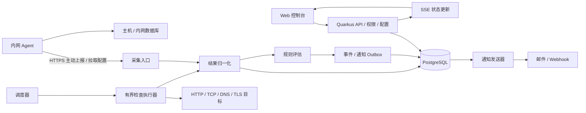

# Geek Monitor 产品与技术规划

文档版本：v0.1  
编写日期：2026-10-10  
状态：实施中；本文中的功能、容量和工期均为设计目标，实施状态见第 12 节。

## 1. 产品定位

Geek Monitor 是面向个人开发者、小型团队和自托管运维场景的统一监控平台，通过一个控制台管理服务器、网站、接口、数据库和基础服务的健康状态，完成“发现异常 → 通知负责人 → 查看证据 → 确认恢复”的闭环。

核心问题：服务是否可用、响应是否变慢、资源是否即将耗尽、故障发生在哪里、谁已经处理。首版追求部署简单、判断可信、告警可用，后续扩展多地域探测和较大规模指标分析。

### 1.1 规划假设

- 首版为单组织使用，可管理多个项目和环境；暂不提供面向客户的商业多租户计费。
- 优先支持 Linux 服务器，数据库优先 PostgreSQL、MySQL 和 Redis。
- 中心服务可访问公网目标；内网服务器通过 Agent 主动连接中心，不要求开放入站端口。
- 延续仓库现有 Kotlin、Quarkus、Gradle 和 Java 21 基础；管理界面先采用浏览器 Web 控制台。
- 首版按最多 100 台主机、500 个主动检查项规划，实际承载能力须经压测确认。

### 1.2 典型使用场景

| 场景 | 用户操作 | 预期结果 |
| --- | --- | --- |
| 网站故障 | 添加 URL、检查间隔和通知渠道 | 连续失败后收到告警，恢复后收到恢复通知 |
| 服务器资源紧张 | 安装 Agent 并选择主机模板 | 查看 CPU、内存、磁盘趋势，提前收到容量告警 |
| 数据库变慢 | 绑定只读监控凭据和探测位置 | 区分连接失败、查询超时、连接数接近上限 |
| 定时备份未执行 | 配置心跳任务并由脚本上报 | 超过预期时间和宽限期后告警 |
| 计划维护 | 设置维护窗口 | 保留检查结果，抑制维护期通知 |

### 1.3 首版边界

首版覆盖可用性、基础性能指标、故障事件和通知。不包含全量日志检索、分布式链路追踪、流量抓包、自动执行修复命令、任意脚本市场或完整 Kubernetes 管理。相关能力通过后续集成解决，避免将第一阶段变成完整可观测性平台。

## 2. 监控对象与采集范围

“资源”表示一台主机、一个网站或数据库实例；“监控项”表示针对资源的一项检查或指标规则。一个资源可以绑定多个监控项，不能仅凭某个端口可连接就判定整个服务健康。

| 类型 | 首版采集或检查 | 后续扩展 | 方式 |
| --- | --- | --- | --- |
| Linux 主机 | CPU、load、内存、swap、磁盘空间/inode、网络收发、在线状态 | 磁盘 I/O、温度、进程与 systemd 服务 | Agent 周期上报 |
| HTTP/HTTPS | 状态码、总耗时、超时、重定向、文本/JSON 断言 | DNS/TCP/TLS/首字节耗时分解、跨地域探测 | 中心或探测节点主动请求 |
| TLS 证书 | 证书有效期、主机名和信任链验证 | 自定义 CA 管理、证书变化事件 | TLS 握手 |
| TCP | 指定端口连通性及建立连接耗时 | 协议握手模板 | 主动连接 |
| DNS | 指定解析器、记录类型、解析结果断言和耗时 | 多解析器一致性 | 主动查询 |
| PostgreSQL/MySQL | 连接、轻量查询、查询耗时、连接数/上限 | 锁等待、复制延迟、慢查询汇总 | 内网 Agent 或探测节点 |
| Redis | PING、内存、客户端数、淘汰计数 | 主从复制与持久化状态 | 内网 Agent 或探测节点 |
| 心跳任务 | 最近运行时间、成功/失败、超时缺报 | Cron 日历与任务耗时分布 | 业务脚本调用上报接口 |
| 容器 | 后续提供 | 容器状态、重启次数、资源、健康检查 | 本地主机采集 |
| 通用指标 | 后续提供 | Prometheus 格式接入、自定义业务指标 | 受控抓取或批量上报 |

### 2.1 检查配置

每个监控项包含名称、所属项目、环境、标签、负责人、目标、探测位置、间隔、超时、判断条件、告警策略、凭据引用和启停状态。

建议初始默认值如下，允许按类型调整：

- HTTP/TCP：60 秒一次，单次总超时 10 秒；HTTP 默认成功状态码为 200–299，可显式修改。
- DNS：60 秒一次，超时 5 秒；明确记录类型及期望结果。
- Agent：30 秒采集并批量上报一次；超过 90 秒未收到心跳进入采集异常。
- 数据库：60 秒一次，总执行预算 10 秒；PostgreSQL/MySQL 使用固定 `SELECT 1`，Redis 使用 `PING`，不执行自定义 SQL。
- TLS：每 6 小时检查一次，默认提前 30/14/7 天分级提醒。
- 心跳任务：首版使用“预期间隔 + 宽限期”，Cron 和时区日历作为扩展。

默认不在一个周期内立即多次重试，由连续失败阈值处理抖动。检查间隔必须大于总执行预算，同一检查不重叠执行。

### 2.2 HTTP 语义

支持 GET/HEAD，POST 仅用于用户明确配置的无副作用检查；支持请求头、认证信息引用、文本包含和 JSON 路径比较。默认最多跟随 5 次重定向，每一跳重新校验目标地址。响应体读取上限建议 1 MiB，默认不保存正文，只保存经过脱敏的错误摘要。

禁用 TLS 校验需要明确提示并记录审计，监控界面持续显示该配置。证书正常、端口连通、HTTP 成功和业务断言成功应分别呈现。

### 2.3 主机及数据库指标语义

CPU 使用率由相邻计数器差分得到，首次采样显示待采集；内存同时展示可用内存和使用率；磁盘按挂载点统计并默认过滤临时伪文件系统。网络速率由累计计数器差分计算，重启或计数器回退时重置基线。

数据库采用内置固定查询模板和最小权限账号，不开放任意 SQL 执行。PostgreSQL/MySQL 使用 `SELECT 1`，Redis 使用 `PING` 做可用性判断；检查成功后还会尝试采集当前连接数、连接上限和利用率。PostgreSQL 连接数按实例统计，MySQL 使用全局状态，Redis 使用 `INFO clients` 与 `CONFIG GET maxclients`。这些指标查询是可选的只读统计：账号权限不足时省略相应指标并保持可用性为 UP，不把指标权限不足误判为数据库故障。指标每 60 秒采样，可在数据库资源曲线中查看；数据库指标阈值规则要求至少 240 秒窗口，覆盖率不少于 80%、采样空洞不超过两个周期，数据不足时规则为 UNKNOWN。数据库凭据应用层加密保存，API 只返回凭据是否已配置；更新时密码留空表示沿用原凭据。启用 PostgreSQL/MySQL TLS 时使用 JVM 信任库验证 CA 链；为固定到已校验 IP 的连接，当前关系型数据库检查尚不校验证书主机名。Redis TLS 校验证书链和主机名。

## 3. 用户功能与页面

### 3.1 页面结构

| 页面 | 主要内容与交互 |
| --- | --- |
| 总览 | 健康/异常/未知资源数量、活跃故障、最近事件、关键资源趋势 |
| 资源列表 | 项目、环境、标签、类型和状态筛选；批量暂停和绑定告警策略 |
| 资源详情 | 当前状态、最后采集时间、指标曲线、检查历史、关联故障和维护记录 |
| 监控配置 | 分类型配置向导、凭据选择、单次试运行及检查结果解释 |
| 故障中心 | 当前/历史事件、级别、确认人、处理备注、通知记录和恢复时间 |
| 告警与通知 | 规则、阈值、通知渠道、分组、静默和维护窗口 |
| Agent 管理 | 注册、在线状态、版本、配置同步状态、吊销和更新提示 |
| 系统设置 | 项目、成员、角色、凭据、保留策略、审计及备份状态 |
| 状态页（后续） | 发布选定服务的可用性和人工公告，不暴露内网信息 |

资源详情提供最近 1 小时、24 小时、7 天、30 天范围。无数据、采集延迟和维护区间必须可见，曲线不得把缺失值补成零或健康。

### 3.2 核心操作流程

1. 创建项目和环境，添加资源。
2. 选择模板，配置目标、采集位置和凭据。
3. 执行一次试运行，展示 DNS、网络、认证或断言错误。
4. 保存监控项，绑定规则和通知渠道。
5. 发生异常后生成事件并发送通知。
6. 负责人确认事件、填写备注；系统检测恢复后关闭事件。

试运行遵守正式检查相同的网络访问策略、超时与限流。通知渠道测试由用户主动触发，并展示“测试通知”标识。

### 3.3 角色

- 管理员：管理成员、项目、凭据、节点和系统配置。
- 运维人员：管理授权项目的监控项、规则和事件，不能读取凭据明文。
- 只读成员：查看授权项目的状态、指标和事件。

首版角色绑定账号，同一账号在所有项目使用同一角色；项目成员关系单独决定可访问范围。管理员可为项目添加新账号或已有账号、移除项目成员并调整账号角色。新账号需设置至少 12 个字符的初始密码；已有账号沿用当前角色。不能通过当前会话修改自身角色，也不能移除或降级某项目的最后一位管理员。

访问控制同时作用于 API、实时事件流和导出；首版单组织也保留项目级访问边界。

## 4. 状态、规则与告警

### 4.1 状态模型

监控健康状态采用 `PENDING`（等待首次结果）、`UP`、`DEGRADED`、`DOWN`、`UNKNOWN`。暂停和维护是独立控制标记，不覆盖原始健康记录。

- 主动检查得到确定的连接失败、超时或断言失败，属于失败证据。
- 探测节点失联、任务未执行、结果过期，属于 UNKNOWN，不能直接判为目标 DOWN。
- 性能阈值持续超限可判为 DEGRADED；核心可用性失败达到阈值后判为 DOWN。
- 主机 Agent 失联生成“采集失联”事件，不能据此断言主机宕机；可结合独立 TCP 检查辅助定位。
- 多监控项资源由标记为“关键”的检查聚合：关键项 DOWN 优先，其次关键项 UNKNOWN，再考虑性能降级；非关键项异常单独展示。

### 4.2 默认规则示例

| 规则 | 触发条件 | 恢复条件 |
| --- | --- | --- |
| HTTP 不可用 | 连续 3 个有效周期失败 | 连续 2 个有效周期成功 |
| 响应变慢 | 连续 5 分钟每次有效采样耗时 > 2 秒 | 连续 3 分钟低于 1.5 秒 |
| CPU 过高 | 连续 5 分钟使用率 > 90% | 连续 3 分钟低于 80% |
| 磁盘空间不足 | 连续 3 次使用率 > 85%；> 95% 升级严重级别 | 连续 3 次低于对应阈值 5 个百分点 |
| 数据库连接紧张 | 连续 3 分钟连接数/上限 > 80% | 连续 3 分钟低于 70% |
| 心跳缺失 | 超过预期间隔与宽限期 | 收到新的有效成功上报 |

以上为可修改模板。持续时间规则要求窗口内有效采样覆盖率至少 80%，且不存在超过两倍采样间隔的空洞；缺失时进入数据不足状态，不跨空洞累计持续时长。

首版规则支持数值比较、连续次数、持续窗口、恢复阈值和严重级别，不开放任意表达式脚本。后续增加组合条件和依赖拓扑。

### 4.3 事件生命周期与降噪

事件按“规则 + 监控项 + 探测位置”去重，状态为打开、已确认、已恢复。确认表示有人处理，不能将服务标为健康。

- 同一异常期间复用事件，累加失败次数；默认每 30 分钟提醒一次，可关闭。
- 支持通知合并和每渠道速率上限，避免大量资源同时失联造成通知风暴。
- 维护期继续采集并记录异常，抑制通知；维护结束后重新累计触发条件。
- 静默只影响通知。Agent 失联时抑制依赖该 Agent 的指标缺失通知，并显示抑制原因。
- 事件关闭后再次达到失败阈值产生新事件，保留故障历史。
- 级别升级绕过普通重复提醒冷却，但仍受渠道速率限制。

首版实现邮件和通用 Webhook；后续通过适配器支持企业微信、钉钉、飞书和 Telegram。通知包含资源、环境、故障时间、实际值、阈值、探测位置和事件链接。

通知采用持久化发送记录、指数退避和最大重试次数，失败可在控制台查看。投递至少一次；向支持的接收方提供幂等键，外部渠道仍可能产生重复消息。发送前检查事件版本，过期的故障消息应取消或改为包含恢复状态的汇总，避免恢复消息之后再收到陈旧故障提醒。

### 4.4 可用率口径

按计划检查周期划分时间片：检查结果最多延续一个配置周期，成功为 UP，确定失败为 DOWN，未执行、结果过期或暂停/停用后尚未重新检查为 UNKNOWN；性能降级但可用的时间仍计入可用率，并作为可用时长的子集单独统计。统计按 UTC 整点小时汇总并保留 180 天。

`可用率 = UP 时长 / (UP 时长 + DOWN 时长)`；同时展示 `数据覆盖率 = (UP + DOWN) / 应监控时长`。维护和暂停时长从应监控时长中剔除，并公开剔除时长；UNKNOWN 不计成功。没有有效结果时展示“无数据”。告警的连续失败确认只控制通知，不抹去之前已观察到的失败时间片。

## 5. 技术架构

### 5.1 首版部署与选型

首版采用模块化单体：一个 Quarkus 应用承载控制台 API、调度、规则与通知，一个 PostgreSQL 实例保存配置和历史，受监控主机按需安装 Agent。前端作为静态资源交付；框架在页面原型阶段确定，不作为监控能力的前置依赖。

沿用当前 JVM 运行方式，原生镜像列为后续优化。Agent 建议独立为小型 Go 程序，以便单文件部署；这是拟定选型，需在 P0 验证平台适配和资源占用后确定。

数据库先统一存储配置、检查结果和受控数量的指标；达到容量边界后，将指标存储抽象接入专用时序系统，关系库继续负责配置与事件。首版不强制依赖 Redis、消息中间件或独立时序数据库。

### 5.2 模块划分

建议在现有 `com.geekcorelab` 包下按业务划分：

| 模块 | 职责 |
| --- | --- |
| identity / project | 用户、角色、项目授权 |
| resource / monitor | 资源、监控定义、模板与配置版本 |
| scheduler / checker | 到期任务、并发限制、协议适配、执行预算 |
| agent / ingestion | 注册、鉴权、配置分发、上报校验和去重 |
| metric / retention | 指标存储、聚合、查询及过期清理 |
| rule / incident | 状态机、规则评估、事件与维护策略 |
| notification | 渠道配置、Outbox、投递与重试 |
| audit / system | 审计、平台自监控及运维接口 |

检查适配器统一输出执行 ID、计划时间、开始/结束时间、探测位置、结果类别、标准指标及脱敏错误码。网络失败、认证失败、权限不足、断言失败和执行器内部错误分别编码。

### 5.3 调度与一致性

首版单中心调度，使用 Quarkus 定时触发器扫描到期监控项，并将到期任务写入持久化执行表；业务监控定义保存在数据库中。调度增加小幅随机偏移，避免整分钟流量峰值。

按探测节点、协议和目标设置并发上限，使用有界队列。任务过期后记为未执行，不在恢复时无上限补跑。一次检查结果必须同时提交结果记录和待评估记录，评估器可在重启后继续处理；事件更新与通知 Outbox 同事务提交。

后续多中心部署引入数据库任务租约、租约代次和唯一执行键，拒绝旧持有者提交过期结果。Quarkus 提供支持持久化和集群调度的 Quartz 扩展，可作为多实例调度候选；业务结果和通知仍须独立实现幂等。[Quarkus Quartz 官方指南](https://quarkus.io/guides/quartz/)

### 5.4 Agent 通信

Agent 通过 HTTPS 主动注册、拉取配置并批量上报；中心不主动连接内网 Agent。注册使用短期一次性令牌，成功后签发独立节点凭据，可单独轮换和吊销。

首版 Agent 只支持内置采集器，不接收任意 Shell 命令。断网时使用有大小与时间上限的本地队列；恢复后限速补传。每批携带节点 ID、启动 ID、递增序号、采样时间和配置版本，服务端据此去重。

历史补传仅更新历史曲线，超过当前状态有效窗口的数据不重新触发即时故障或恢复；时钟偏移超出阈值时标记采样不可信，以服务端接收时间辅助判断节点在线状态。

## 6. 数据模型与接口草案

### 6.1 核心实体

| 实体 | 关键字段与约束 |
| --- | --- |
| Project / Membership | 项目、用户、角色；成员关系唯一 |
| Resource | 项目、类型、名称、环境、标签、负责人 |
| Monitor | 资源、检查类型、目标配置、间隔、超时、探测节点、配置版本 |
| Credential | 加密密文、密钥版本、用途、授权范围；API 不返回明文 |
| Agent | 节点标识、凭据摘要、版本、最后心跳、配置版本 |
| CheckExecution | 执行 ID、计划时间、租约、状态；监控项/位置/计划时间唯一 |
| CheckResult | 执行 ID、采样/接收时间、状态、耗时、错误码；执行 ID 唯一 |
| MetricSample / MetricRollup | 资源、指标名、受限标签、时间、值；聚合保存 count/sum/min/max |
| AlertRule | 监控项、条件、窗口、恢复阈值、级别、版本 |
| Incident / IncidentEvent | 去重键、状态、打开/恢复时间、确认人、状态变更历史 |
| NotificationOutbox / Delivery | 事件版本、渠道、幂等键、尝试次数、下次发送时间 |
| Maintenance / AuditLog | 作用范围、有效期；操作人、操作类型、脱敏变更摘要 |

检查结果和指标按时间分区，索引围绕项目、监控项、资源和时间范围设计。活跃事件施加去重约束。删除监控项采用软删除，历史结果按保留策略清理。

### 6.2 API 范围

统一使用 `/api/v1`，分页、过滤和错误码采用同一约定；更新配置带版本号以检测并发覆盖。

| 方法与路径 | 用途 |
| --- | --- |
| `GET/POST /projects`、`/resources`、`/monitors` | 查询与创建项目、资源、监控项 |
| `GET/PATCH/DELETE /monitors/{id}` | 查看、更新与软删除 |
| `POST /monitors/{id}/test` | 限流的单次试运行 |
| `GET /monitors/{id}/results` | 分页查询历史检查结果 |
| `GET /resources/{id}/metrics` | 按时间和分辨率查询曲线 |
| `POST /agent-enrollments` | 管理员生成短期注册令牌 |
| `POST /agents/register` | 节点兑换注册凭据 |
| `GET /agents/{id}/config` | 节点拉取授权配置 |
| `POST /agents/{id}/batches` | 幂等批量上报 |
| `POST /heartbeats/{id}`、`POST /heartbeats/{id}/rotate-token` | 任务专用凭据认证的心跳上报与管理员凭据轮换 |
| `GET /incidents`、`POST /incidents/{id}/ack` | 查询与确认故障 |
| `GET/POST/DELETE /maintenance-windows`、`/notification-silences`、`/notification-channels` | 管理维护、通知静默和通知渠道 |
| `GET /system/status`、`GET /audit-log` | 管理员查看数据库、保留策略、最近备份状态和带游标的脱敏审计记录 |
| `GET /events/stream` | 经授权过滤的 SSE 状态变化流 |

批量接口返回逐项接收状态，限制批大小、标签数量及请求体尺寸；查询接口限制时间范围和返回点数。

## 7. 安全与运行可靠性

### 7.1 目标访问边界

监控产品需要访问内网，因此按探测节点配置允许访问的域名、网段和端口。默认拒绝云元数据地址、回环、链路本地及未授权私网目标；需要监控特定内网网段时，由管理员显式放行。

HTTP、TCP、DNS、数据库连接、试运行和 Webhook 均应用访问策略。DNS 解析后验证全部候选地址，连接时使用已验证的地址；HTTP 重定向逐跳重新校验，并保留正确 Host/SNI，防止通过地址变化绕过限制。除协议适配器需要的协议外，不开放其他 URL scheme。

### 7.2 凭据与节点权限

凭据采用应用层 AES-GCM 加密，主密钥通过 `GEEK_MONITOR_ENCRYPTION_KEY` 外部提供，不与数据库备份一起存放。监控 API 不返回数据库密码或密文，只返回是否已配置；日志、通知、审计及配置导出必须脱敏。数据库 TLS 使用关系型数据库的 JVM CA 信任库验证，Redis 同时验证证书主机名。

数据库账号仅授予对应模板所需权限。下发给 Agent 的凭据视为该节点可以访问的秘密，只允许分配授权目标；本地凭据文件限制读取权限。Agent 默认非 root 运行，需要额外权限的采集器单独声明。后续容器监控不得默认暴露或挂载具备管理能力的容器运行时 socket。

登录、写操作和节点注册限流；浏览器会话使用安全 Cookie 与 CSRF 防护，自动化 API 使用独立可吊销令牌。公网部署统一启用 TLS。

### 7.3 平台自身监控

对外提供存活和就绪检查，并记录任务积压、调度延迟、结果新鲜度、上报拒绝数、规则处理延迟、通知成功率、数据库容量和清理任务状态。中心无法采集时，控制台展示平台异常，历史绿色状态不能持续冒充当前健康。

中心停止期间无法依靠自身发送故障通知，生产部署应由独立外部探针监控中心可用性。

## 8. 容量、保留策略与部署

### 8.1 容量预算

以 500 个主动检查项、60 秒间隔计算，每天约 720,000 条结果；保留 7 天约 504 万条。以 100 台主机、每台 50 条指标序列、30 秒间隔计算，每天约 1,440 万个指标点；保留 3 天约 4,320 万点。指标维度增加会直接放大该规模。

因此“单关系库首版”只在受控序列数、批量写入、分区清理和聚合验证通过后成立。实际磁盘量必须使用真实行宽、索引和 WAL 测量，不用裸数据大小替代容量结论。

初始保留建议：

| 数据 | 保留期限 |
| --- | --- |
| 原始主动检查结果 | 7 天 |
| 原始主机/数据库指标 | 3 天 |
| 5 分钟聚合 | 30 天 |
| 1 小时聚合与可用率统计 | 180 天 |
| 故障、通知和审计记录 | 180 天 |

聚合任务成功落库后再清理原始数据。指标汇总保存计数、总和和极值；可用率聚合应保存各状态时长。需要跨窗口 P95 时必须保存可合并的分布结构，不能平均各窗口 P95。

指标标签只允许稳定、数量受控的维度，不将请求 ID、完整 URL、错误正文或任意用户输入作为标签；这是控制时序数量的重要约束。[Prometheus 指标与标签命名实践](https://prometheus.io/docs/practices/naming/)

### 8.2 性能验收目标

以下指标是 P0/P4 需要验证的目标：

- 目标规模下，95% 的任务在计划时间后 5 秒内开始；超时目标不会耗尽全部执行槽位。
- 默认 60 秒间隔、连续 3 次失败时，持续故障在约 190 秒内确认，再于 30 秒内完成首次通知投递尝试；渠道到达时间另行统计。
- 常规资源列表和 24 小时聚合曲线查询 P95 小于 2 秒。
- 中心重启后恢复调度，已接收结果和未发送通知不丢失。
- Agent 资源目标为平均 CPU 小于单核 1%、内存小于 50 MiB；按采集器和真实机器测量。

### 8.3 部署形态

开发环境提供应用与 PostgreSQL 的 Compose 配置；生产初期使用单机容器部署，数据库和配置密钥持久化，Agent 以 systemd 服务运行。中心与数据库的初始评估资源可设为 4 vCPU、8 GiB 内存和 SSD，属于压测起点，不作为容量承诺。容器启动、升级、备份和恢复步骤见[部署手册](deployment.md)。

升级前备份数据库与配置，迁移采用版本管理并优先保持前后兼容；应用回滚与数据库回滚分别制定流程。定期演练恢复，初始目标 RPO 24 小时、RTO 2 小时。单中心存在停机采集空窗，后续高可用版本再解决。

## 9. 分阶段实施计划

以下工期按 1 名熟悉技术栈的全职开发者估算，不包含等待外部环境和大范围需求变化；总计约 9–13 人周，应在 P0 后重新评估。

| 阶段 | 工期估算 | 交付物 | 进入下一阶段的条件 |
| --- | --- | --- | --- |
| P0 设计与验证 | 1 周 | 页面原型、数据模型、Agent 技术验证、容量样本 | 确定首版规模和存储策略；跑通一个端到端采集样例 |
| P1 可用性闭环 | 2–3 周 | 登录权限、项目/资源、HTTP/TCP/DNS/TLS、调度、事件、邮件/Webhook、基础页面 | 故障触发、降噪、恢复和通知重试贯通 |
| P2 主机与数据库 | 3–4 周 | Linux Agent、主机指标、PostgreSQL/MySQL/Redis、心跳任务、曲线 | 断网补传、权限不足、凭据轮换均有确定行为 |
| P3 运维完善 | 1–2 周 | 维护窗口、审计、保留聚合、备份恢复、部署文档 | 完成安全边界与恢复演练 |
| P4 首版验收 | 2–3 周 | 压测报告、故障演练报告、安装包/镜像、试运行修复 | 通过目标规模及至少 7 天试运行 |

P1 是可试用里程碑；完整首版包含 P1–P4，确保服务器、Web、数据库三个核心范围全部交付。后续版本再加入多地域探测、中心高可用、容器、状态页、专用时序存储及外部可观测性集成。

## 10. 验收清单

本节为整体实施验收标准；阶段性验证的覆盖范围见第 12 节，其余场景仍待执行。

| 类别 | 验收场景 | 通过标准 |
| --- | --- | --- |
| Web | 正常、500、超时、错误正文、非法证书、重定向 | 分类正确；按阈值触发及恢复；端口连通不覆盖业务失败 |
| 主机 | CPU 超限、磁盘空间不足、Agent 停止 | 指标正确；采集失联与主机故障明确区分 |
| 数据库 | 正常、停机、错误凭据、查询超时、指标权限不足 | 错误分类正确；无写操作；单项权限缺失不误判宕机 |
| 心跳 | 按时上报、缺报、重复上报、失败上报 | 按宽限期处理；去重；失败不误报恢复 |
| 告警 | 抖动、确认、级别升级、维护、重复投递 | 无重复活跃事件；维护抑制正确；记录完整 |
| 数据 | 重复批次、乱序、断网补传、时间偏移 | 去重有效；过期结果不篡改当前健康状态 |
| 重启 | 执行中断、规则未处理、通知未发送时重启 | 可恢复；遗漏检查显示未知；通知不会静默丢失 |
| 权限 | 跨项目访问、只读写入、凭据查询 | API 与 SSE 均拒绝越权；无明文秘密泄露 |
| 网络边界 | 元数据地址、未授权内网、DNS 地址变化、跨域重定向 | 实际连接均受允许范围约束 |
| 容量 | 目标规模运行、慢目标、通知风暴、数据库空间不足 | 达到性能目标；有界退化；平台自身异常可见 |
| 数据保留 | 聚合失败、跨分区查询、过期清理 | 聚合失败不提前删原始数据；统计口径一致 |
| 恢复 | 从备份恢复到干净环境 | 配置、历史与凭据可恢复；达到约定 RPO/RTO |

首版交付时应附部署说明、Agent 安装与卸载说明、数据库监控账号权限说明、指标与状态字典、告警配置说明以及备份恢复手册。

## 11. 待确认决策

当前文档已按可执行默认方案编写，开发前优先确认以下事项：

1. 首批真实资源数量、数据库版本和内网分布，以校准容量和采集权限。
2. 首个必须接入的通知平台；默认邮件加通用 Webhook。
3. Web 控制台的框架与视觉方案；默认桌面运维优先并兼容移动查看。
4. 是否需要 Windows Agent、多组织租户或多地域节点；这些需求会改变首版边界。
5. 实际可接受的数据丢失和恢复时间，以及是否需要从首版启用中心高可用。

## 12. 当前仓库与规划的关系

### 已实现

- Flutter Web 管理台、首次安装、管理员登录、Cookie 会话、项目和资源基础管理。
- 项目成员管理 API 与 Flutter 页面：按项目添加/移除成员、调整账号级管理员/运维/只读角色并写入审计；只读账号的资源写入被拒绝，运维账号只能在已加入的项目内操作。
- Flutter 系统设置与审计页面：展示数据库大小、迁移版本、统一保留策略、最近备份记录和游标分页审计日志；系统状态和审计 API 仅管理员可访问，审计摘要中的密码、令牌和备注等字段会脱敏。
- PostgreSQL 备份脚本在生成并校验归档后记录最新文件名、大小、SHA-256 和完成时间；管理台按 24 小时新鲜度显示状态。该记录不证明备份异机复制或恢复成功。
- JVM 部署提供 `/q/health/live` 和 `/q/health/ready`；就绪检查包含 PostgreSQL 数据源状态，Compose 可持久化数据库卷并等待数据库就绪。
- HTTP GET/HEAD 检查配置、定时调度、有界执行器、手动试运行、检查历史、失败/恢复阈值和关键资源状态聚合。
- 进程重启后按执行所属进程回收遗留的 `RUNNING` 检查记录；同进程的超时执行在宽限期后转为 `UNKNOWN` 并触发重查，迟到结果不能覆盖恢复状态。
- 故障去重、确认备注、事件时间线，以及恢复后自动关闭。
- 项目级邮件/Webhook 渠道、AES-GCM 加密配置、事务 Outbox、幂等键、失败重试和投递记录。
- HTTP、TCP、DNS、TLS 检查适配器；DNS 支持记录类型、指定解析器、记录断言和 PTR 反向查询，TLS 校验证书信任链、主机名及剩余有效期。
- HTTP/TCP/TLS 目标和 Webhook 的公网/私网访问策略、DNS 答案校验及重定向限制；网络检查固定到已校验的地址。
- 项目级或资源级维护窗口、审计记录、检查结果持续采集、维护期通知抑制，以及窗口起止/提前取消后的失败恢复计数重置。
- 项目级或资源级定时通知静默；故障状态与事件照常记录，通知 Outbox 保留并延至静默结束或提前取消后投递。
- 同一渠道同类事件在 15 秒聚合窗口内合并投递；每条事件仍保留独立 Outbox 和投递记录，并可设置每分钟 1–600 批的渠道上限。
- TLS 证书每 6 小时检查；首次进入剩余 30 天时创建证书事件，进入 14/7 天时升级为 HIGH/CRITICAL，并在新证书有效期超过 30 天后恢复。
- 同一未恢复故障默认每 30 分钟生成一次持续提醒，可按监控项配置为 0–1440 分钟或关闭；TLS 级别升级立即通知并重置重复提醒计时，通知仍遵守维护、静默及渠道速率策略。
- Linux Agent 注册与数据入口：管理员为 HOST 资源签发 15 分钟一次性令牌，服务端仅存令牌/节点凭据摘要；支持配置拉取、批次去重、时钟可信标记和节点凭据吊销。
- Go Linux Agent 采集 CPU、load、内存、swap、磁盘空间/inode 和网络吞吐；断网队列限制为 64 MiB/7 天，按启动 ID、序号顺序补传。
- HOST 指标可信数据查询和 Flutter 管理台曲线；不可信时钟样本被排除，图表保留缺失区间。
- 主机指标阈值规则可绑定 HOST 指标，设置比较方向、触发/恢复值、120–86400 秒窗口及事件级别；规则仅评估可信样本，要求窗口覆盖率至少 80% 且采样空洞不超过两倍周期，数据不足记为 UNKNOWN。持续超限生成 PERFORMANCE 事件并将资源标为 DEGRADED，满足恢复条件后自动关闭事件。
- Agent 注册时自动建立不显示在普通监控列表中的采集在线检查；超过 90 秒未上报生成独立 COLLECTION 事件，不把 Agent 失联当成主机 DOWN。依赖 Agent 的指标数据不足时返回 UNKNOWN 并写明 AGENT_OFFLINE/AGENT_NOT_REGISTERED 抑制原因；恢复上报自动关闭事件，吊销凭据会关闭关联检查和活跃事件。

### 尚未完成

- P1：真实 SMTP 服务联通与投递演练；整体故障注入验收。
- P2：PostgreSQL/MySQL/Redis 的只读可用性检查、连接数/上限/利用率采集、数据库指标趋势查询和阈值规则已实现；统计查询权限不足时可用性检查保持 UP，缺少有效指标覆盖的阈值规则返回 UNKNOWN。Agent HTTP 回放测试和本地 Linux Agent/PostgreSQL 17 断连演练覆盖上传失败后保留队列、恢复后按 FIFO 补传；每周期最多重放 10 批以控制恢复流量。多机和 Agent 故障通知渠道投递仍待验证。心跳任务 API、Agent 失联事件与指标缺报抑制、Flutter 凭据管理和主机指标阈值规则已实现。
- P3：指标原始数据 3 天、5 分钟聚合 30 天、小时聚合 180 天、检查结果 7 天以及已结束事件、终态通知和审计记录 180 天清理已实现；清理按有界批次运行，保留未解决事件和未完成投递。数据库备份/空库恢复脚本、Compose 部署配置和部署手册已实现。检查状态的 UP/DOWN/UNKNOWN 时长、可用率/覆盖率、降级时长和维护/暂停剔除统计已实现；本地一次性数据库 RPO/RTO 计时恢复演练已完成，生产备份周期和异机恢复仍待验证。
- P4：本地合成调度/曲线压测与 JVM 镜像运行 smoke test 已完成；100 台主机、每日 1440 万样本的持续写入容量，目标硬件压测、至少 7 天连续试运行和完整验收报告仍待完成。

本地手动及定时验收已覆盖 TCP 连通/策略拒绝、DNS A/AAAA/PTR（含自定义解析器）、公开 TLS 证书校验和受信任的短有效期证书在 30/14/7 天阈值的升级、续期恢复、维护期检查保留和失败计数重置，以及静默期 Outbox 延迟和提前取消后立即恢复投递。重复提醒已通过本地数据库及 Webhook 验证：默认配置可设短间隔演练、关闭后不再生成事件，TLS 升级会重置冷却且升级通知与后续提醒均返回 HTTP 202。分组、TLS 开启/升级/恢复通知均由本地 Webhook 返回 HTTP 202，分组成员及独立投递记录可在数据库/API 中核对。开发环境的邮件通道使用 Quarkus Mailer 模拟器；真实 SMTP（待配置测试服务后演练）、生产部署、容量目标和完整故障矩阵尚未验收。后续实现应继续按阶段记录验证证据，不把本地构建或健康检查当作生产验收。

心跳任务本地演练覆盖成功上报与重复 `runId` 去重、显式失败开事件、成功后恢复并关闭事件、旧报告不覆盖最新状态、超过间隔与宽限期后缺报，以及令牌轮换后旧令牌拒绝、新令牌可用；任务摘要中的 password/token/API key/Bearer 凭据也已验证会在存储前脱敏。

Agent 手动 E2E 已在本地 Linux 主机和 PostgreSQL 17 上验证：V12/V13 迁移、一次性令牌重放拒绝、Agent 启动采样和可信曲线、重复批次幂等、延迟 8 分钟但时钟已校准的历史样本仍进入曲线、上报的 8 分钟时钟偏差样本被排除、吊销后配置访问返回 401。Go HTTP 测试模拟 503 后按 FIFO 成功补传（含重复批次的 HTTP 200 确认）；真实多机和 Agent 故障通知渠道投递仍未覆盖。

2026-10-11 在一次性 PostgreSQL 17.11 与本机 Linux Agent 上完成真实进程断连/恢复演练：Agent 在线时先写入批次 1；停止中心应用后继续运行 Agent，批次 2 进入权限为 `0600` 的本地 outbox；恢复应用后，Agent 在下一采集周期按 FIFO 补传批次 2，并提交新采样批次 3。数据库按当前启动 ID 仅有序号 1、2、3 各一条，三批的已接收指标数与落库样本数分别为 10/10、21/21、21/21；批次 2 的采样时间早于接收时间约 30 秒，outbox 恢复为空。认证指标 API 返回 21 条序列、146 个点。该演练暴露原实现每周期只移除一批、积压无法消退的问题；现改为每周期按 FIFO 最多补传 10 批，并由 Go 回归测试验证失败保留、成功后有限批量清空及顺序。此证据覆盖一台本机 Agent 的短时断连恢复，不代表多机故障或通知渠道投递。

2026-10-11 在一次性 PostgreSQL 17.11 上并发运行两个独立 Linux Agent 进程，各使用单独的一次性注册令牌和 `0600` 状态目录，绑定到不同 HOST 资源。两个 Agent API 状态均为 ONLINE；每个分别提交序号 1、2 两批，资源各存储 31 项指标，认证曲线 API 各返回 21 条序列、31 个点。该验证覆盖同机双进程的凭据、批次和资源隔离，不替代异机网络环境验证。

主机指标阈值规则在本地 PostgreSQL 17 手动演练：V15 迁移成功；可信高 CPU 样本由后台调度触发 DEGRADED 状态、HIGH 级 PERFORMANCE 事件和资源降级；样本不足返回 UNKNOWN；持续低于恢复值后事件自动 RESOLVED、资源恢复 UP。演练使用 120 秒窗口，临时资源已软删除，Agent 凭据已吊销。该演练未连接真实 SMTP。

Agent 离线闭环在本地 PostgreSQL 17 手动演练：V16 迁移成功；超过 90 秒未上报会生成 COLLECTION 事件，主机资源不会因此判为 DOWN；依赖指标返回 UNKNOWN 并注明 AGENT_OFFLINE，恢复上报会自动解决事件，恢复后的再次失联生成新事件，吊销 Agent 凭据可关闭活跃事件并写入原因。测试仅对临时 Agent 的 last_seen_at 做了定向时间偏移以加速演练；没有配置通知渠道，因此没有验证该类事件的渠道投递。

2026-10-11 在一次性 PostgreSQL 17.11 上完成应用重启恢复演练，Flyway 升至 V20：数据库加入执行所属进程 ID；为旧进程注入一条已启动的 `RUNNING` 检查和一条运行中 Outbox，停止并重启应用后，检查历史转为 `UNKNOWN/EXECUTION_INTERRUPTED`，启用监控项立即产生由新进程领取的检查记录；测试 URL 指向回环地址，因此按网络策略得到 `UNKNOWN/TARGET_BLOCKED`。将 Outbox 的领取时间提前 3 分钟后，重启恢复逻辑重新领取该通知，经 Quarkus Mailer 模拟器投递为 DELIVERED，投递记录仅有一次成功。Outbox 时间偏移用于缩短回收等待；邮件模拟器不代表 SMTP 投递验收。

数据库可用性检查在本地空白 PostgreSQL 17、MySQL 8.4 和 Redis 7 上经 API 试运行：PostgreSQL/MySQL `SELECT 1`、Redis 无密码/ACL `AUTH`/选择 DB 后的 `PING` 返回 UP；错误 PostgreSQL 和 Redis 凭据返回 `AUTHENTICATION_FAILED`；回环地址按目标策略返回 `UNKNOWN/TARGET_BLOCKED`。MySQL TLS/CA 校验使用本地测试 CA 通过。创建、GET、PATCH 响应只显示凭据配置状态；数据库内仅保存 AES-GCM 密文，省略密码更新后检查仍成功。

数据库指标在本地 PostgreSQL 17 上完成端到端演练：V17 迁移创建指标表；定时检查采集实例连接数、连接上限与利用率并写入曲线查询 API；数据库指标阈值规则以测试样本触发 DEGRADED 和 HIGH 级 PERFORMANCE 事件，低于恢复值后自动 RESOLVED、资源恢复 UP。临时阈值规则已软删除，原 PostgreSQL 检查已恢复启用。高低样本由本地测试数据库定向注入，因此这验证了采集、落库、查询和规则闭环，不代表真实容量压力测试。采集查询另在 MySQL 8.4 的只读账号和 Redis 7 上验证：MySQL 返回全局连接统计；仅授权 `PING` 的 Redis ACL 用户仍为 UP，`INFO`/`CONFIG` 权限不足时指标为空。临时资源、监控项、数据库容器和凭据均为本地测试数据；真实 SMTP 投递、生产 CA、容量目标、生产部署和完整故障矩阵尚未验收。

指标保留在本地 PostgreSQL 17 上验证：V18 迁移创建 5 分钟与 1 小时 rollup 表；超过 3 天的原始指标先汇总再删除，超过 30 天的 5 分钟 rollup 汇总为小时数据。注入的两组历史点分别在 4 天和 40 天窗口通过 API 返回，采样数、加权平均、最小值和最大值一致；查询自动返回 300 秒或 3600 秒分辨率。超期检查记录按批删除也已验证。聚合与原始删除同事务提交；大规模容量和长时间运行仍待压测。

备份恢复在本地 PostgreSQL 17 验证：custom dump 可通过 `pg_restore --list` 检查，恢复脚本验证 SHA-256 并拒绝非空目标库；恢复到新库后，用户、项目、资源、监控、事件和迁移版本计数与源库一致。打包后的 JVM 应用连接恢复库通过 Flyway 18、就绪探针并允许测试管理员登录。另一次隔离计时演练使用合成安装数据和一次性 PostgreSQL 17 容器：最后确认写入至备份落盘相隔 21.25 秒，SHA-256 校验和空库恢复脚本通过；源库与恢复库的用户/项目/成员计数均为 1，恢复后 Flyway 为 V19，就绪探针、管理员登录和项目 API 均返回 HTTP 200。从开始创建恢复库到认证项目 API 可用耗时 19.39 秒。该本机结果满足本次 RPO 24 小时、RTO 2 小时目标，但不证明生产备份频率、异机备份可取回性或生产网络下的恢复时间。演练数据库、备份、cookie 和临时密钥已清理。

可用率在本地 PostgreSQL 17 完成 V19 迁移与 API 演练：UP、DOWN、UNKNOWN、DEGRADED 样本按各自检查周期累计；15 分钟资源暂停和 15 分钟维护窗口被剔除。两小时样本返回可用率与覆盖率均为 66.67%，UP（含降级）2400 秒、DOWN 1200 秒、UNKNOWN 1800 秒、剔除 1800 秒；Flutter 历史窗口支持 24 小时、7/30/180 天。登录本机 Flutter Web 后，历史弹窗成功展示统计与最近检查记录，24 小时、7 天、30 天和 180 天切换均更新覆盖率和时间线。暂停/恢复 API 也验证会写入并关闭暂停区间。缺少已保存检查历史的活跃时段在查询时按 UNKNOWN 补足，避免把缺少历史数据误当成已观测的健康状态。

2026-10-11 在一次性 PostgreSQL 17.11 和隔离 JVM 应用上完成成员管理 API E2E：以 `admin@biliwind.com` 初始化；只读成员不能创建资源、项目或查看成员列表；运维角色更新会立即反映到已有会话，能在已授权项目创建资源但不能向未加入项目写入；成员移除后项目和资源列表立即收敛，已有账号可加入另一项目；最后管理员移除/降级保护生效，4 条新增/角色变更/移除操作均写入审计。Flutter Web 构建与 `flutter analyze` 通过；该 E2E 未验证真实 SMTP。

2026-10-11 在一次性 PostgreSQL 17.11 和隔离 JVM 应用上验证 180 天保留任务与 Flyway V21：过期审计、已恢复事件及其事件时间线、终态通知和投递记录均被清理；近期记录、超过 180 天仍未解决的事件以及待发送通知均保留。执行器每轮使用 10,000 条上限的索引批次。

2026-10-11 在一次性 PostgreSQL 17.11 和隔离 JVM 应用上验证系统状态、审计 API 与 Flyway V22：系统状态返回 schema V22、数据库大小、保留策略和空备份状态；审计 25 条分页游标无重复，密码和备注值脱敏，非管理员访问返回 403。真实运行 `backup-postgres.sh` 生成权限为 `0600` 的归档和校验文件后，最新备份元数据写入数据库并显示 CURRENT；将记录时间偏移 25 小时后显示 OVERDUE。该测试只覆盖本机归档记录。

2026-10-11 在一次性 PostgreSQL 17.11 和隔离 JVM 应用上查看首次安装流程：打包 Flutter Web 初始化页在 Edge 正常渲染；无效邮箱和短于 12 位的密码均返回 HTTP 400，安装状态保持未初始化。单独运行 `fvm flutter run -d web-server` 后，调试模式初始化表单预填指定测试账号，界面明确标注仅供开发测试，密码保持掩码。有效测试账号提交与登录后的可用率历史弹窗浏览器验收仍待完成。

P4 本地合成负载基线使用 PostgreSQL 17 和 JVM 应用：500 个 HTTP 检查同时到期时，500/500 均在 5 秒内启动，启动延迟 P95 为 971 毫秒；500 条资源列表在派发期间 100 次顺序查询 P95 为 6.21 毫秒。单台 HOST 使用 50 条指标序列、30 秒间隔回放 24 小时共 144,000 个样本，10 次 24 小时曲线请求 P95 为 441 毫秒，返回 50 条序列、71,950 个聚合点，响应约 7.7 MB；7/30/180 天窗口也均返回 HTTP 200。构建的 JVM 镜像在隔离数据库上通过 Flyway V19、就绪检查、管理员登录、项目 API 和指标 API，容器以 UID 185 运行。这是本机合成基线，不代表规划的 4 vCPU/8 GiB 目标主机或 100 台 HOST 的合计样本量；真实写入容量、外部网络检查、CPU/内存峰值和 7 天连续运行仍待验收。
